# Complete FYP Guide & Architectural Reconstitution: Project Granite

> **Document Type:** Comprehensive Project Orientation & Technical Synthesis  
> **Project Code:** F26-060-Granite  
> **Official Title:** *A Self-Healing Multi-Agent System for Semantic Error Diagnosis, Verified Repair and Recovery*  
> **Short Title / Brand:** **Granite** (formerly *TraceCause* / *AgentTestLab* / *Agent Autopsy*)  
> **Supervisor:** Dr. Muhammad Adil Majeed  
> **Institution:** FAST National University of Computer and Emerging Sciences (NUCES), School of Computing  
> **Team Members & Technical Ownership:**  
> - **Shahoud Shahid (23i-2515)** — Data & Benchmark Engineering Owner  
> - **Muhammad Noor (23i-2520)** — Diagnosis Engine Owner  
> - **Saif Shahzad (23i-2634)** — Platform, Recovery & Deployment Owner  

---

# 1. Start With the Big Picture

### What is the project?
**Granite** is an automated **debugger, flight recorder, and self-healing engine for multi-agent AI systems**. 

In the AI world today, developers no longer use just a single chatbot. Instead, they build **teams of AI agents** (Multi-Agent Systems or MAS) where different specialized AI workers collaborate—for example, a *Planner Agent* creates a task list, a *Research Agent* searches a database, a *Coder Agent* writes code, and a *Verifier Agent* reviews the output.

When these complex AI teams make a mistake and fail, finding out **which agent broke the pipeline, at what exact step, why it happened, and how to fix it** is notoriously difficult. Granite is a software platform and installable software development kit (SDK) that automatically monitors the AI team, pinpoints the root-cause culprit agent and step, detects sneaky "silent errors", generates and tests a targeted fix using counterfactual replay, and resumes the workflow safely.

---

### What problem does it solve?
1. **The Blame Game in AI Teams:** When a team of 4 AI agents fails after a 50-step run, human engineers currently have to read thousands of lines of messy JSON logs to figure out who messed up. Granite automates this root-cause attribution.
2. **Silent Failures:** Often, an AI agent outputs an answer that looks completely polished, polite, and well-formatted, but is factually or mathematically wrong (e.g., calculating a total as $20.00 instead of $19.75). Standard monitoring tools miss this because no error code or crash occurred. Granite detects these semantic constraint violations without needing an expensive LLM call.
3. **Guesswork in Fixing Bugs:** Developers usually tweak a prompt and hope the entire AI workflow gets fixed, often accidentally breaking other steps. Granite tests proposed fixes in an isolated sandbox (*counterfactual replay*) before applying them.

---

### Why is this problem important?
Companies are putting multi-agent AI into production for mission-critical tasks: automated customer support, medical data extraction, legal document drafting, and autonomous software engineering. If an agent silently hallucinates a wrong discount or bad code, companies lose money, trust, and compliance.

---

### Who has this problem & Who will use our system?
- **AI Software Engineers & Developers** building multi-agent workflows with frameworks like LangGraph or CrewAI.
- **QA & Reliability Engineers (LLMOps/DevOps)** who need automated testing and post-mortem incident reports.
- **Researchers** studying multi-agent failure propagation.

---

### What is our proposed solution?
Granite provides a lightweight, framework-agnostic **Python SDK** that hooks into agent frameworks (CrewAI, LangGraph), records an **Execution Graph (DAG/Cycle)** of all interactions, runs **deterministic Semantic Error Diagnostics**, performs **Backward Causal Tracing** to identify the culprit, uses a **Repair Agent** to propose a precise fix, measures fix recovery through **Verified Automatic Repair (controlled replay)**, and reports everything via a clean **Web Dashboard**.

---

### A Simple Real-World Example
> **Imagine an E-Commerce Customer Support AI Team:**
> 
> * **Currently:** A customer asks to return a purchased jacket after 40 days. 
>   - *Agent 1 (Policy Reader)* checks the store policy (which allows returns up to 30 days only) but misreads "30 days" as "45 days" due to a subtle prompt ambiguity.
>   - *Agent 2 (Accountant)* calculates the full refund of $100.
>   - *Agent 3 (Email Writer)* writes a polite email: *"Your $100 refund has been approved!"*
>   
>   The system didn't crash. Every tool returned JSON `status: 200 OK`. The company loses $100 incorrectly. When the engineering team realizes the mistake later, an engineer spends 2 hours digging through 100 pages of logs to find out why Agent 3 sent that email, mistakenly blaming Agent 2 or 3 before finally finding Agent 1's mistake.
> 
> * **With Granite:**
>   - Granite intercepts the workflow trace.
>   - The **Semantic Error Diagnostic** checks the output against the store's programmatic business rules (`return_window <= 30`) and immediately flags a **Silent Failure**.
>   - The **Backward Causal Tracer** traverses the dependency graph back to Step 2: *Agent 1 (Policy Reader)*.
>   - The **Repair Agent** suggests a corrected parameter for Agent 1.
>   - Granite runs a **Controlled Counterfactual Replay** from Step 2 to verify that with the fix, the customer is correctly and politely informed about the 30-day limit.
>   - Granite notifies the engineer on the dashboard: *"Culprit: Policy Reader at Step 2 (Confidence: 87%). Verified repair available."*

---

# 2. Understand the Original FYP Idea & Its Evolution

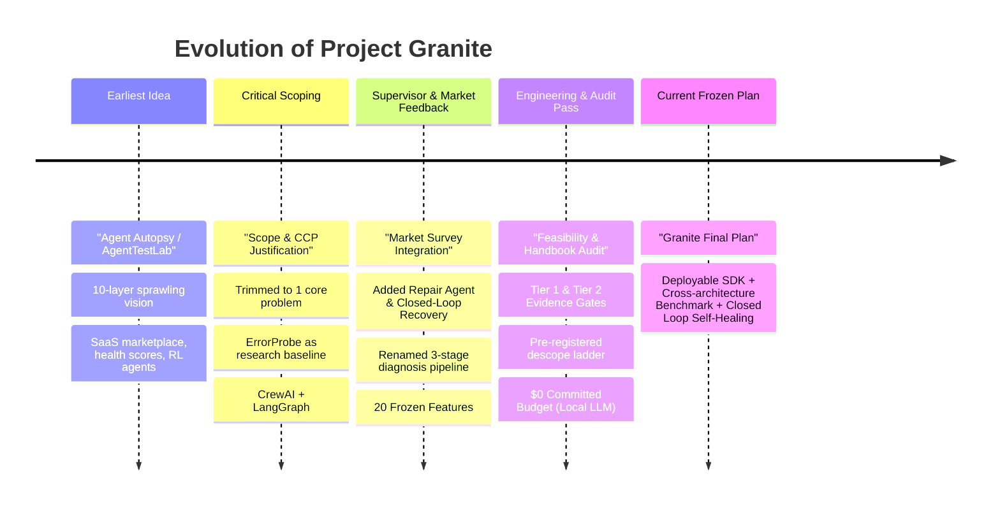

### Timeline & Evolution Breakdown

#### Phase 1: The Original Pitch (Earliest Documents)
- **Document Source:** [`TraceCause_AgentTestLab_Pitch.md`](file:///d:/University%20Work/Semester%207/FYP-1/Final-Year-Project/markdowns/06-archive-superseded/TraceCause_AgentTestLab_Pitch.md) and [`TraceCause_Product_Vision_UI.md`](file:///d:/University%20Work/Semester%207/FYP-1/Final-Year-Project/markdowns/06-archive-superseded/TraceCause_Product_Vision_UI.md).
- **Original Concept:** Called *"Agent Autopsy 2.0"* or *"AgentTestLab"*. It was an un-scoped, 10-layer mega-platform including:
  - Multi-agent observability + RL-based proactive clarification.
  - 17-screen Mission Control UI with 3D force-directed graphs.
  - Multi-tenant SaaS billing, user auth, team subscriptions, and an "Agent App Marketplace".
  - Complex Reinforcement Learning (RL) agents for real-time steering.
- **Status:** **Superseded & Frozen** (Kept for historical context).

#### Phase 2: The Critical Scoping Pass
- **Why it changed:** The original pitch failed the university's "single shared problem" test and violated the FAST FYP Guide’s warning against "feature accumulation" and SaaS plumbing.
- **Decisions Made:**
  - Removed all commercial SaaS fluff (billing, auth, marketplace).
  - Selected a peer-reviewed baseline: **ErrorProbe (ACL 2026 Findings)**, which holds the State of the Art (59.5% step accuracy on the Who&When benchmark).
  - Defined the academic **Delta**: ErrorProbe fails on silent errors and only works on architectures it was tuned on. Granite extends diagnosis to new frameworks (CrewAI, LangGraph) and catches silent errors.

#### Phase 3: Market Survey & Supervisor Alignment
- **Document Source:** [`Agentic_AI_Market_Survey_Full_Content_and_Integration.md`](file:///d:/University%20Work/Semester%207/FYP-1/Final-Year-Project/markdowns/03-market-and-literature-research/Agentic_AI_Market_Survey_Full_Content_and_Integration.md).
- **Changes:**
  - Added **Repair Agent** (generating candidate fixes).
  - Reclassified **Recovery Controller** (checkpoint-based resumption) and **Verified Repair Memory** (storing successful fixes) as core components to achieve a complete "self-healing" loop.
  - Renamed the 3 stages of diagnosis to **Culprit Agent (Strategist)**, **Error Step Localization**, and **Verification Agent (Investigator)** to show individual defensibility.

#### Phase 4: Feasibility Engineering & Audits (Current State)
- **Document Source:** [`01_Executive_Audit_and_Verdict.md`](file:///d:/University%20Work/Semester%207/FYP-1/Final-Year-Project/01_Executive_Audit_and_Verdict.md) and [`06_Expanded_Scope_and_Feasibility_Plan.md`](file:///d:/University%20Work/Semester%207/FYP-1/Final-Year-Project/06_Expanded_Scope_and_Feasibility_Plan.md).
- **Key Realizations & Final Decisions:**
  - **Dataset Correction [Confirmed]:** Discovered that AgenTracer's *TracerTraj-2.5K* dataset was never publicly released (only 127 sample rows). Switched baseline reproduction solely to *Who&When* (184 real, MIT-licensed cases in hand).
  - **Budget Commitment [Confirmed]:** Committed to a **$0 cost profile** by using local Ollama (Llama-3/Qwen) models for all baseline runs and evaluation.
  - **Evidence Tiering [Confirmed]:** Split the 10 core features into **Tier 1** (proven by 8 working POC spikes) and **Tier 2** (Recovery Controller & Repair Memory, guarded by pre-registered Mid-1 pass/fail gates).

---

# 3. Problem Statement

### 1. Current Problem
Multi-agent AI architectures suffer from cascading, non-deterministic errors. When a failure manifests at Step 20, the actual root cause was often introduced at Step 3 by an entirely different agent. Because downstream agents transform and mask earlier outputs, locating the true failure origin requires tedious manual inspection of unstructured logs.

### 2. Users Affected
Software development teams, LLMOps engineers, and AI researchers deploying autonomous multi-agent pipelines in production environments (customer service, automated coding, data analysis).

### 3. Existing Solutions
1. **Commercial Observability Platforms:** LangSmith, Langfuse, Arize, Braintrust, Opik.
2. **Academic Research Methods:** Who&When (ICML 2025), AgenTracer (ICLR 2026), Scope Delineation (AAAI 2026), TraceElephant (ACL 2026), ErrorProbe (ACL 2026).

### 4. Limitations of Existing Solutions
- **Commercial tools only record traces; they don't diagnose:** They provide dashboards to view traces, but still require a human to manually guess the root cause. Newer features (LangSmith Engine, Arize Alyx) lack benchmarked step-level attribution accuracy and do not offer counterfactual fix verification.
- **Academic tools are anomaly-gated and blind to silent failures:** The best academic method, ErrorProbe, only triggers when a visible anomaly occurs according to a taxonomy. When an agent outputs an answer that looks structurally valid but is factually or mathematically wrong, ErrorProbe misses it completely.
- **Lack of cross-architecture generalization:** Prior academic research only evaluated systems against the specific, custom agent frameworks used to build their benchmarks. None have demonstrated generalization to popular production frameworks like CrewAI and LangGraph.

### 5. Our Solution
Granite builds a framework-agnostic diagnosis and recovery platform that:
1. Normalizes traces from CrewAI and LangGraph into an execution graph.
2. Unconditionally checks task-spec constraints to catch silent semantic errors without expensive LLM calls.
3. Performs backward causal tracing and hypothesis verification.
4. Generates targeted fixes and validates them through controlled counterfactual replay.
5. Resumes execution safely.

> ### 2–3 Sentence Problem Statement for Supervisor / Defense
> *"Multi-agent AI systems frequently suffer from cascading failures where errors surface far downstream from their originating step, while existing diagnostic tools fail to detect silent, well-formed semantic errors and have never been evaluated on unseen orchestration architectures. Granite solves this by combining deterministic task-constraint verification with graph-based causal attribution and counterfactual replay, providing an installable, framework-agnostic platform that localizes root causes, verifies candidate repairs, and safely recovers failed agent workflows."*

---

# 4. Project Objectives

### Main Objective
To design, implement, and evaluate a framework-agnostic, self-healing software platform and SDK that automatically detects semantic failures (including silent errors), attributes the root-cause agent and step in multi-agent workflows, and verifies candidate repairs via counterfactual execution.

### Supporting Objectives Table

| Objective | Simple Explanation | How We Will Achieve It | Status / Quality Assessment |
| :--- | :--- | :--- | :--- |
| **Obj 1: Multi-Framework Instrumentation** | Hook into different agent libraries to capture clean execution traces. | Build adapter hooks for CrewAI and LangGraph that normalize traces into a unified JSON/graph schema. | **Realistic & Clear** (POC Spike 2 verified CrewAI). |
| **Obj 2: Ground-Truth Benchmark Creation** | Create a standardized dataset with known, injected bugs to test diagnostic tools. | Implement programmatic fault-injection operators on GSM8K and tau-bench retail tasks to build a 500–1,000 trace benchmark. | **Realistic & Essential** (Replaces manual labeling). |
| **Obj 3: Silent Failure Detection** | Catch wrong outputs that look perfectly normal. | Develop the *Semantic Error Diagnostic (SED)* that evaluates machine-checkable task constraints with 0% LLM overhead. | **Realistic & High Impact** (Closes ErrorProbe's stated blind spot). |
| **Obj 4: Causal Root-Cause Attribution** | Accurately identify which agent and step broke the pipeline. | Adapt ErrorProbe's 3-stage pipeline (Strategist, Investigator, Arbiter) over structural execution graphs. | **Realistic & Audited** (Acceptance band pre-registered). |
| **Obj 5: Verified Repair & Counterfactual Replay** | Propose a fix and prove it works before applying it. | Combine LLM-based *Repair Agent* with a *Controlled Replay Protocol* (frozen upstream context, pinned decoding). | **Realistic & Proven** (POC Spike 5 & 8 verified). |
| **Obj 6: Safe Workflow Recovery** | Resume the AI workflow from the fix point instead of starting from scratch. | Implement *Recovery Controller* on LangGraph checkpoints, falling back to replay-based resumption if needed. | **Gated (Tier 2)** (Has pre-registered Mid-1 fallback). |
| **Obj 7: Deployable Platform & Dashboard** | Make it a real, usable developer tool, not just a research script. | Build a FastAPI backend, PostgreSQL store, React dashboard, and Docker container. | **Realistic & Functional** (Running prototype in `poc-demo/`). |

---

# 5. Scope of the FYP

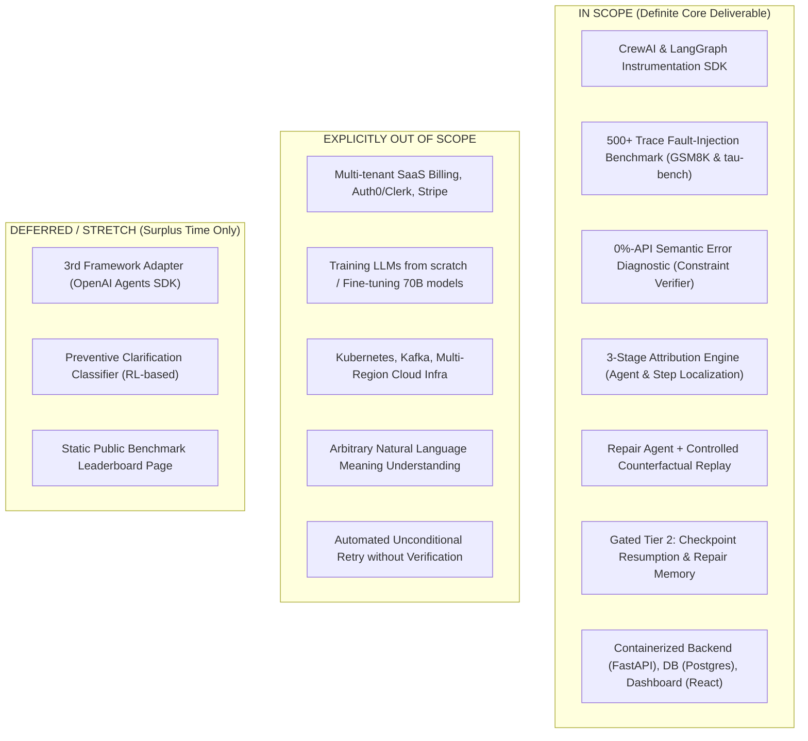

- **In Scope [Confirmed]:** 10 foundational mechanisms (8 Tier 1 + 2 Tier 2), 500+ trace benchmark with negative clean controls, execution graph parsing, single-container Docker deployment, 3-screen React dashboard.
- **Out of Scope [Confirmed]:** Commercial SaaS plumbing (subscriptions, payment gateways, complex user management), message queues (Kafka), enterprise disaster recovery, and generic open-ended semantic parsing without formal constraints.
- **Deferred / Stretch [Confirmed]:** 7-framework broad compatibility layer, reinforcement learning for proactive clarification, and automated PR generator for GitHub.

---

# 6. System Requirements

### Functional Requirements (FR)

| ID | Requirement Name | What the System Must Do | Priority | Evidence / Origin |
| :--- | :--- | :--- | :--- | :--- |
| **FR1** | **Fault Injection & Ground Truth** | Inject controlled, deterministic corruptions into CrewAI/LangGraph workflows and record ground-truth culprit agent and step. | **Must Have (P0)** | [Confirmed] Plan §0.07 |
| **FR2** | **Root-Cause Attribution** | Ingest execution traces and output predicted responsible agent, originating step, and confidence score. | **Must Have (P0)** | [Confirmed] Plan §0.07 |
| **FR3** | **Semantic Error Diagnostic** | Flag outputs that pass structural/anomaly checks but violate task-spec constraints (silent failures), running unconditionally. | **Must Have (P0)** | [Confirmed] Plan §0.07 |
| **FR4** | **Counterfactual Replay & Verification** | Re-run downstream steps from a candidate fix under a frozen upstream context and report measured recovery rate over $N$ replays. | **Must Have (P0)** | [Confirmed] Plan §0.07 |
| **FR5** | **Framework-Agnostic SDK** | Provide an installable Python SDK hooking into target workflows without modifying internal diagnosis logic. | **Must Have (P0)** | [Confirmed] Plan §0.07 |
| **FR6** | **Repair Generation** | Automatically generate candidate prompt, parameter, or tool-argument corrections for the localized error step. | **Must Have (P0)** | [Confirmed] Plan §7.0 (Item 6) |
| **FR7** | **Checkpoint Resumption** | Resume execution from the verified repair point using orchestration state saves. | **Should Have (P1)** | [Confirmed] Tier 2 Gate (LangGraph) |
| **FR8** | **Repair Memory** | Index and retrieve past verified error-diagnosis-repair triplets to accelerate recurring failure resolution. | **Should Have (P1)** | [Confirmed] Tier 2 Gate |
| **FR9** | **Incident Reporting & Visualization** | Display execution graph, culprit step, confidence, and counterfactual recovery on a 3-screen web console. | **Must Have (P0)** | [Confirmed] `poc-demo/` |

### Non-Functional Requirements (NFR)

| Requirement | Metric / Target | Explanation | Priority |
| :--- | :--- | :--- | :--- |
| **Diagnostic Overhead** | $< 50\%$ wall-clock time | The time spent diagnosing a trace must not exceed half of the original trace's execution duration. | **Suggested P0** |
| **Zero-API Core Logic** | $\ge 80\%$ Own Logic ($< 20\%$ API) | Graph construction, SED, tracing, and scoring must run 100% locally with 0 LLM calls; LLMs are used only for repair reasoning. | **Mandatory (P0)** |
| **Silent Failure FPR** | $< 5\%$ False Positive Rate | The SED must not raise false alarms on healthy, correct execution traces (verified against clean negative controls). | **Suggested P0** |
| **Privacy & PII Safety** | 100% Regex PII Redaction | Sensitive user data in execution traces must be scrubbed before database persistence. | **Mandatory (P1)** |
| **Zero-Dollar Budget** | $\$0.00$ Additional Compute | Full baseline reproduction and evaluation pipeline must execute on local Ollama open-weights models. | **Mandatory (P0)** |

---

# 7. Users and Actors

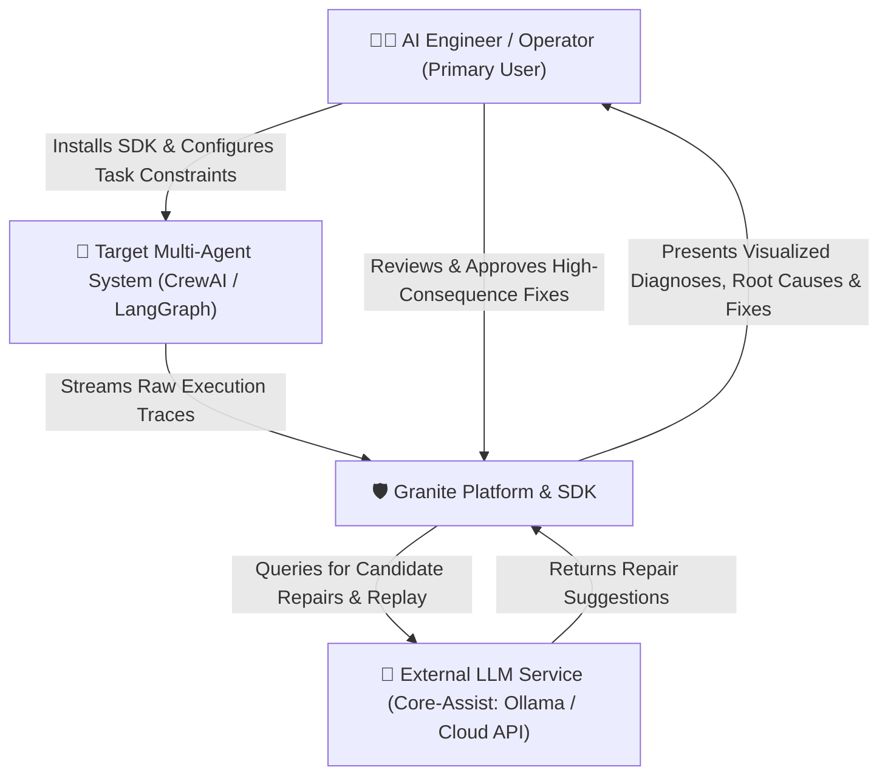

1. **AI / Software Engineer (Primary Actor):**
   - *Who:* Developer building and maintaining multi-agent pipelines.
   - *Goal:* Fast debugging, locating silent errors, fixing prompts/tools safely.
   - *Provides:* Target workflow code, task specifications/constraints.
   - *Receives:* Root-cause culprit agent/step, confidence scores, visual execution graph, verified repair proposals.
2. **Target Multi-Agent System (Secondary Actor):**
   - *Who:* Autonomous LLM agents executing tasks (e.g., CrewAI researchers, LangGraph coders).
   - *Provides:* Raw runtime telemetry (messages, tool inputs/outputs, state snapshots).
   - *Receives:* Injected test faults (in benchmark mode) or repaired states (in recovery mode).
3. **Core-Assist LLM Provider (External Service):**
   - *Who:* Local Ollama instance or external LLM API.
   - *Role:* Powers the *Repair Agent* and executes counterfactual downstream replays. (Strictly isolated from graph parsing and SED).

---

# 8. Complete Feature Matrix

| Feature | User | Purpose | Priority | Dependencies |
| :--- | :--- | :--- | :--- | :--- |
| **1. Fault Injection Harness** | Benchmark Eng. | Deterministically corrupts agent steps to build labeled evaluation ground truth. | **P0 (Tier 1)** | Framework Adapters |
| **2. Cross-Arch Benchmark** | Benchmark Eng. | Standardized testbed of 500+ traces spanning multiple frameworks. | **P0 (Tier 1)** | Fault Harness, GSM8K/tau-bench |
| **3. Culprit Agent Localizer** | AI Engineer | Hypothesizes and identifies the specific responsible agent in a failure. | **P0 (Tier 1)** | Execution Graph Normalizer |
| **4. Error Step Localizer** | AI Engineer | Pinpoints the exact chronological and causal step where the bug originated. | **P0 (Tier 1)** | Culprit Localizer, Graph Builder |
| **5. Verification Agent** | System | Cross-checks the attribution hypothesis against raw trajectory evidence. | **P0 (Tier 1)** | Step Localizer |
| **6. Repair Agent** | AI Engineer | Generates targeted corrections for prompts, tool arguments, or parameters. | **P0 (Tier 1)** | Verification Agent, LLM API |
| **7. Semantic Error Diagnostic (SED)** | AI Engineer | Programmatically evaluates machine-checkable task constraints to catch silent failures. | **P0 (Tier 1)** | Task Specifications |
| **8. Verified Automatic Repair** | AI Engineer | Re-runs downstream execution under frozen context to measure fix recovery rate. | **P0 (Tier 1)** | Repair Agent, Replay Protocol |
| **9. Recovery Controller** | System | Resumes live execution from the verified repair point via checkpoints. | **P1 (Tier 2 Gate)**| Verified Repair, LangGraph Checkpoint |
| **10. Verified Repair Memory** | System | Vector/relational cache storing proven fixes for instant future reuse. | **P1 (Tier 2 Gate)**| Verified Repair, Vector DB |
| **11. Multi-Framework Adapters** | AI Engineer | Captures traces transparently from CrewAI and LangGraph. | **P0 (Tier 1)** | Target Agent Frameworks |
| **12. 3-Screen Web Dashboard** | AI Engineer | Interactive UI displaying run listings, DAG/cycle graph viewer, and repair details. | **P0 (Tier 1)** | FastAPI Backend, Postgres |

---

# 9. System Modules & Architecture

```text
Granite Architecture
│
├── 1. Data & Benchmark Subsystem (Owner: Shahoud Shahid)
│   ├── Multi-Framework SDK Instrumentation (CrewAI & LangGraph hooks)
│   ├── Rule-Based Fault Injection Operators (Tool corruption, context drop)
│   └── Benchmark Store & Dataset Pipelines (GSM8K & tau-bench retail)
│
├── 2. Diagnosis Engine Subsystem (Owner: Muhammad Noor)
│   ├── Trace Normalizer & Execution Graph Builder (DAG & Cyclic graph parsing)
│   ├── Semantic Error Diagnostic (SED) (0%-API constraint checking)
│   └── 3-Stage Backward Causal Tracer (Strategist → Investigator → Arbiter)
│
└── 3. Platform & Recovery Subsystem (Owner: Saif Shahzad)
    ├── Repair Agent & Controlled Counterfactual Replay Engine
    ├── Recovery Controller (Checkpoint Resumption) & Verified Repair Memory
    ├── FastAPI Backend Service & PostgreSQL Persistence Store
    └── React / TypeScript Web Console (3-Screen Dashboard)
```

### Detailed Subsystem Breakdown

#### Subsystem 1: Data & Benchmark Engineering (Shahoud Shahid)
- **Purpose:** Provide standardized instrumentation hooks to capture execution data from arbitrary agent frameworks and generate large-scale ground-truth benchmarks.
- **Inputs:** Raw runtime events from CrewAI and LangGraph; public tasks from GSM8K and tau-bench.
- **Processing:** Normalizes telemetry into standardized JSON traces; applies deterministic fault injection operators (corrupted tool output, swapped parameters).
- **Outputs:** Labeled benchmark traces with known culprit agent and originating step.

#### Subsystem 2: Diagnosis Engine (Muhammad Noor)
- **Purpose:** Identify why and where a multi-agent system failed, catching both blatant crashes and silent semantic errors.
- **Inputs:** Normalized execution traces and task constraint specifications.
- **Processing:** Builds structural dependency graphs (0% API); runs parallel, unconditional constraint checks (SED); traces backwards from failure nodes; verifies hypotheses against evidence.
- **Outputs:** Diagnosis records containing culprit agent, error step, confidence score, and failure propagation path.

#### Subsystem 3: Platform, Recovery & Deployment (Saif Shahzad)
- **Purpose:** Turn diagnostic outputs into actionable, verified fixes, safely recover the agent workflow, and present results to users.
- **Inputs:** Diagnosis records and candidate fix parameters.
- **Processing:** Invokes *Repair Agent* to construct targeted code/prompt patches; executes *Verified Automatic Repair* via counterfactual replays; triggers checkpoint resumption; handles database storage and serves REST APIs.
- **Outputs:** Measured recovery rates, updated workflow states, and interactive web dashboard screens.

---

# 10. Proposed System Architecture & Data Flow

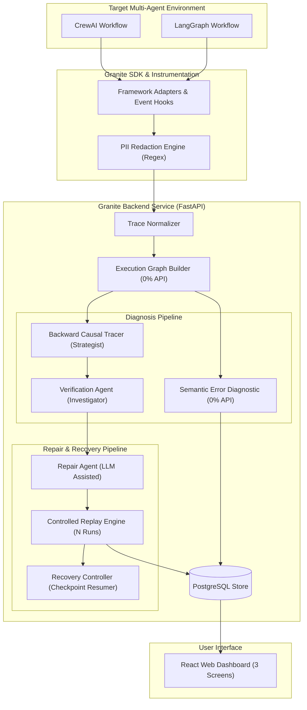

### How Components Communicate & Work
1. **Trace Ingestion:** The Target Agent System runs. Granite’s SDK captures each step (Agent Name, Tool Called, Input Arguments, Returned Output, Timestamps).
2. **PII Sanitization & Graph Building:** The raw trace is scrubbed of sensitive data and parsed into a directed dependency graph. Edges represent explicit data flow between agents.
3. **Dual-Track Diagnosis:**
   - **Track A (SED):** Checks the final output against task rules (e.g., math validity, JSON schema, retail return policy). If violated, flags a *Silent Failure*.
   - **Track B (Causal Tracer):** Traverses the graph backwards from the error point to identify the earliest deviation.
4. **Hypothesis Verification:** The *Verification Agent* checks if the candidate step truly caused the downstream failure.
5. **Repair & Controlled Replay:** The *Repair Agent* drafts a corrected prompt or tool argument. The *Replay Engine* freezes all steps before the bug, injects the candidate fix at the culprit step, and re-executes downstream steps $N=5$ times to compute the empirical **Recovery Success Rate**.
6. **State Resumption & Display:** If the fix succeeds, execution resumes. The complete diagnosis and repair record is stored in PostgreSQL and displayed on the React console.

---

# 11. Technology Stack

| Category | Technology Chosen | Purpose in Granite | Selection Status | Alternatives Considered & Rejected |
| :--- | :--- | :--- | :--- | :--- |
| **Backend API** | **Python / FastAPI** | High-performance async REST API for trace ingestion and pipeline orchestration. | **Confirmed** | Flask (too slow/synchronous), Node.js (poor AI/Python library interoperability). |
| **Frontend UI** | **React / TypeScript / Tailwind** | Responsive 3-screen developer console and interactive graph visualizer. | **Confirmed** | Streamlit (too restrictive for custom DAG visualization), Plain HTML/JS. |
| **Database** | **PostgreSQL (SQLAlchemy)** | Relational store for normalized runs, execution graphs, diagnoses, and repairs. | **Confirmed** | MongoDB (lacks relational integrity for graph edges), SQLite (insufficient concurrency). |
| **Graph Modeling**| **NetworkX (Python)** | Deterministic in-memory graph representation, BFS traversal, and cycle detection. | **Confirmed** | Neo4j (overkill infrastructure for trace-level subgraphs). |
| **AI / LLM Engine**| **Ollama (Llama-3 / Qwen)** | Free, local LLM execution for Repair Agent and baseline reproduction ($0 budget). | **Confirmed** | Paid OpenAI/Anthropic APIs (explicitly rejected to eliminate ongoing compute costs). |
| **Instrumentation**| **CrewAI & LangGraph SDKs**| Target multi-agent orchestration frameworks for validation and generalization. | **Confirmed** | AutoGen / MagenticOne (already studied in prior literature; lack novelty). |
| **Containerization**| **Docker / Docker Compose** | Single containerized deployment running outside the developer's local machine. | **Confirmed** | Kubernetes (unnecessary complexity for FYP scale). |
| **CI / Testing** | **GitHub Actions / Pytest** | Automated regression test suite enforcing step-attribution accuracy thresholds. | **Confirmed** | Manual test execution. |

---

# 12. Data Flow Lifecycle

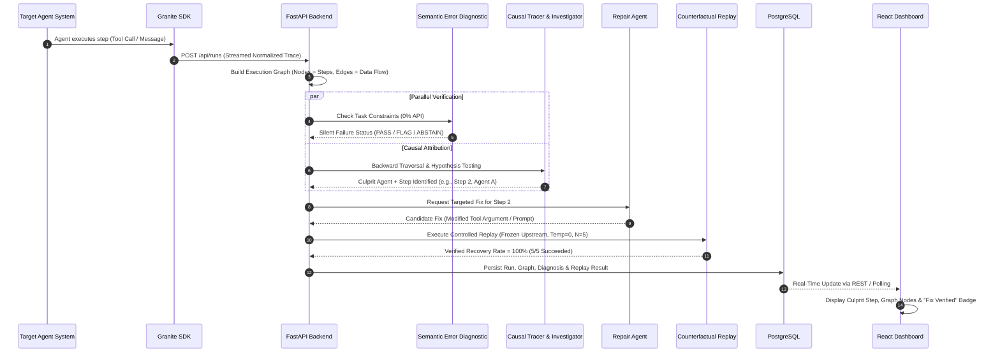

---

# 13. Database Schema & Data Planning

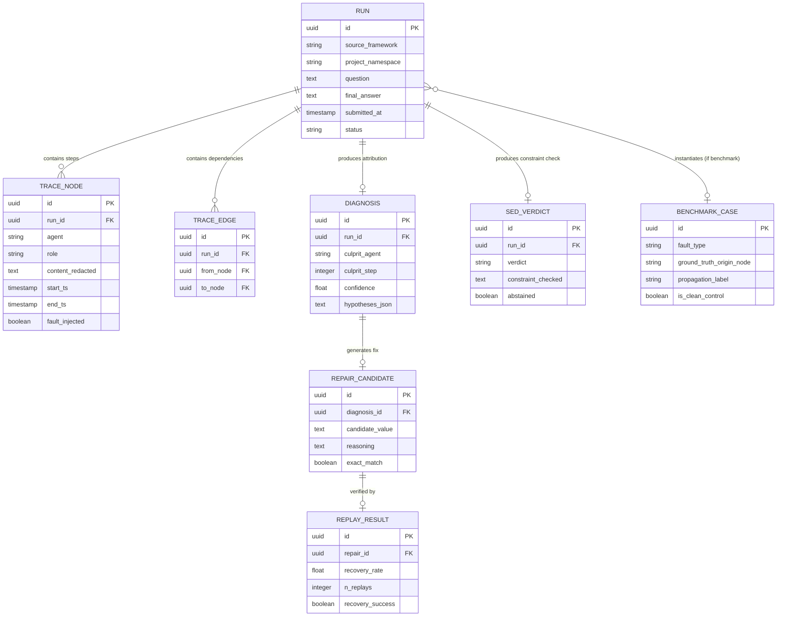

### Data Categorization
- **User / Target Generated Data:** Raw execution telemetry (agent names, roles, prompts, tool outputs, message payloads).
- **System Generated Data:** Execution graphs, SED constraint verdicts, backward attribution hypotheses, confidence scores, candidate repairs, replay recovery rates.
- **Permanent Data:** Benchmark test cases, verified repair memories, historical diagnosis records for regression tracking.
- **Temporary / Ephemeral Data:** Intermediate counterfactual replay sandboxes, raw unredacted trace buffers (scrubbed immediately upon ingestion).

---

# 14. AI & Machine Learning Pipeline

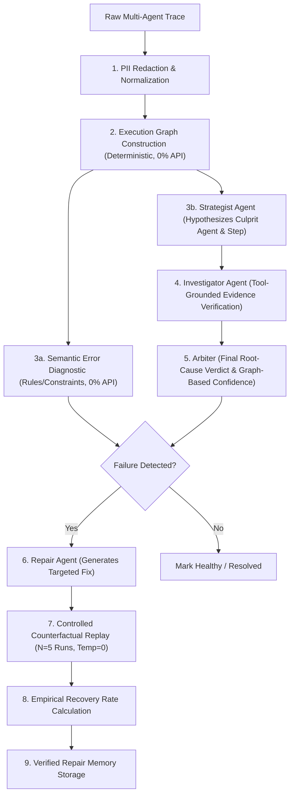

### AI Pipeline Component Details

| Step / Component | Input | Model / Method | Output | API Dependency |
| :--- | :--- | :--- | :--- | :--- |
| **Graph Construction** | Normalized Trace JSON | Structural identifier parsing (GraphTracer method) | Directed Graph (DAG / Cycles) | **0% (Pure Code)** |
| **SED (Silent Failure)** | Final Output + Task Spec | Deterministic Constraint Validator (Regex, numeric boundaries, policy rules) | `PASS`, `FLAG`, or `ABSTAIN` | **0% (Pure Code)** |
| **Strategist (Attribution)** | Execution Graph Nodes | LLM Prompted Reasoner (ErrorProbe Stage 1) | Candidate Culprit (Agent, Step) | **LLM Assisted** |
| **Investigator (Verification)**| Candidate + Trajectory | Evidence-grounded verifier against tool logs (ErrorProbe Stage 2)| Supported / Not Supported | **LLM Assisted** |
| **Confidence Scoring** | Execution Graph Topology | Graph Centrality & Degree Metrics (0% API) | Score $[0.0, 1.0]$ | **0% (Pure Code)** |
| **Repair Agent** | Culprit Step + Error Log | LLM Code/Prompt Modifier | Targeted Patch (Tool Argument / Prompt) | **LLM Assisted** |
| **Replay Verifier** | Candidate Patch + Graph | Sandboxed Re-execution Harness ($N=5$ iterations) | Recovery Rate ($\%$) | **LLM Assisted** |

### Datasets, Training & Evaluation Metrics
- **Evaluation Datasets:** *Who&When* (184 real, annotated cases for baseline reproduction); *GSM8K* (math reasoning) and *tau-bench retail* (customer service policy) for the new cross-architecture benchmark.
- **Model Training:** No large model training from scratch. Granite utilizes pre-trained instruction-tuned open LLMs (via Ollama) as modular reasoning engines.
- **Core Evaluation Metrics:**
  - **Top-1 Agent Accuracy:** Did the system identify the correct broken agent?
  - **Top-1 Step Accuracy:** Did the system locate the exact originating error step?
  - **Propagation-Path F1:** How accurately did the system trace downstream error spread?
  - **Silent-Failure Precision, Recall & Coverage:** Performance on anomaly-free constraint violations.
  - **Recovery Rate:** Percentage of previously failed workflows converted to success after repair.
  - **False Alarm Rate (FPR):** Verification that healthy workflows are not falsely flagged ($<5\%$ target).

---

# 15. Research Component & Academic Contribution

```text
Existing Research (Who&When, ErrorProbe)
  ├── 59.5% Step Accuracy SOTA on in-distribution benchmarks
  ├── Blind to "silent failures" (anomaly-gated only)
  └── Evaluated only on frameworks used during benchmark creation
         │
         ▼
Research Gap
  ├── How to detect well-formed, non-anomalous semantic failures?
  ├── Does attribution generalize to unseen frameworks (CrewAI, LangGraph)?
  └── Can candidate repairs be empirically verified before deployment?
         │
         ▼
Granite's Proposed Contribution
  ├── 1. Data Contribution: First cross-framework fault-injection benchmark (500+ traces)
  ├── 2. Method Contribution: Deterministic SED constraint verifier + Counterfactual replay
  └── 3. System Contribution: Installable, framework-agnostic developer SDK & platform
```

### What Makes This More Than a Standard Software App?
Granite addresses an open computing research problem identified across 7 recent top-tier papers (ICML 2025, ICLR 2026, AAAI 2026, ACL 2026). It does not simply wrap an API; it formalizes execution-graph modeling for multi-agent workflows, develops a zero-cost deterministic constraint checking methodology, and conducts the field’s first rigorous cross-architecture generalization measurement.

---

# 16. Development Plan & Methodology

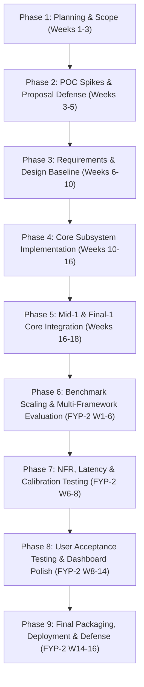

- **Phase 1 (Weeks 1–3):** Problem exploration, literature review of 7 papers, initial scope definition.
- **Phase 2 (Weeks 3–5):** Proposal-stage technical spikes (**8 completed POC runs**), Proposal Defense.
- **Phase 3 (Weeks 6–10):** Formal Software Design Specification (SDS), Tier 2 decision gate resolution, baseline reproduction setup.
- **Phase 4 (Weeks 10–16):** Core build across three assigned owners (Instrumentation, Diagnosis, Platform).
- **Phase 5 (Weeks 16–18):** Mid-1 / Final-1 gate: End-to-end integration of walking skeleton.
- **Phase 6 (FYP-2 Weeks 1–6):** Scale benchmark to 500+ traces, cross-framework evaluation against CrewAI and LangGraph.
- **Phase 7 (FYP-2 Weeks 6–8):** Diagnostic overhead benchmarking ($<50\%$), confidence calibration (Brier score), false-alarm rate audit ($<5\%$).
- **Phase 8 (FYP-2 Weeks 8–14):** User acceptance testing (UAT) with proxy developers, time-to-integrate measurement ($<30$ mins), UI refinements.
- **Phase 9 (FYP-2 Weeks 14–16):** Final Docker packaging, open-source repository release, comprehensive final report, and Final Defense.

---

# 17. Project Milestones & Gate Deliverables

| Academic Gate | Semester & Week | Key Work Packages | Minimum Defensible Deliverable |
| :--- | :--- | :--- | :--- |
| **Gate 1: Proposal Defense** | FYP-1 (Week 5) | Literature audit, scope freezing, 8 POC spikes. | Approved scope, 8 verified POC outputs on disk, 10-slide defense deck. |
| **Gate 2: Mid-1 Review** | FYP-1 (Week 10) | SDS design baseline, Tier 2 decision gates. | Walking skeleton end-to-end; Tier 2 gate outcomes recorded; full reproduction numbers. |
| **Gate 3: Final-1 Exit** | FYP-1 (Week 18) | Core subsystem integration, CrewAI/LangGraph hooks. | Integrated core diagnosing real workflows; SDK installable locally; benchmark $\ge 200$ traces. |
| **Gate 4: Mid-2 Review** | FYP-2 (Week 8) | Benchmark scaling, evaluation against ErrorProbe, NFR testing. | Benchmark $\ge 500$ traces; evaluation report with 95% CIs and ablations; containerized deployment off dev machine. |
| **Gate 5: Final-2 Defense** | FYP-2 (Week 16) | UAT evaluation, final documentation, open-source release. | Fully working deployed platform, complete research report, video demo, public benchmark & SDK. |

### What Needs to be Completed First & Why?
The **Execution Graph Builder and Normalizer** must be completed before any diagnosis or repair work begins. Without a standardized graph data structure, neither the causal tracer nor the repair engine has a valid data format to operate on.

---

# 18. Module-by-Module Task Breakdown

```text
1. Data & Benchmark Subsystem (Shahoud Shahid)
   ├── Implement CrewAI event hook adapter
   ├── Implement LangGraph state listener adapter
   ├── Build deterministic tool-output corruption operator
   ├── Build context-truncation and parameter-swapping operators
   ├── Ingest GSM8K and tau-bench retail datasets
   ├── Generate 500+ labeled benchmark traces (including 15-20% clean controls)
   └── Package benchmark datasheet and MIT/CC-BY release metadata

2. Diagnosis Engine Subsystem (Muhammad Noor)
   ├── Build structural execution graph parser (Nodes, Edges, Cycles)
   ├── Implement Semantic Error Diagnostic (SED) constraint evaluator
   ├── Implement Strategist agent (hypothesis generation)
   ├── Implement Investigator agent (tool-grounded evidence verifier)
   ├── Implement Arbiter and graph-centrality confidence scoring
   ├── Run Who&When baseline reproduction on local Ollama backbone
   └── Conduct ablation studies (Verification Gate OFF, SED OFF, Memory OFF)

3. Platform, Recovery & Deployment Subsystem (Saif Shahzad)
   ├── Implement Repair Agent prompt and argument patch generator
   ├── Build Controlled Counterfactual Replay harness (N=5 runs, Temp=0)
   ├── Implement LangGraph checkpoint resume module (Tier 2 Gate)
   ├── Implement Vector/SQL Verified Repair Memory cache (Tier 2 Gate)
   ├── Build FastAPI REST service endpoints (/api/runs, /repair, /replay)
   ├── Design PostgreSQL relational persistence schema & migrations
   ├── Build React/TypeScript 3-screen dashboard (List, Graph Viewer, Details)
   └── Package multi-container Docker Compose deployment
```

---

# 19. Task Dependencies & Concurrency

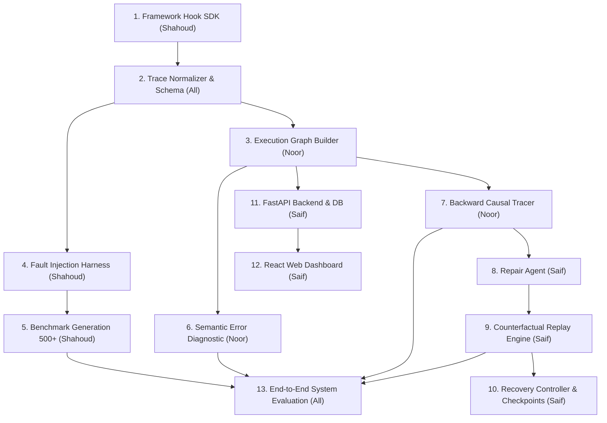

- **Strictly Sequential Tasks:** SDK Hooks $\rightarrow$ Normalizer $\rightarrow$ Graph Builder $\rightarrow$ Causal Tracer $\rightarrow$ Repair Agent $\rightarrow$ Replay Engine.
- **Simultaneous / Parallel Tasks:**
  - Shahoud builds the Fault Injection Benchmark while Noor builds the SED and Attribution Engine.
  - Saif builds the Web Dashboard and Backend API while the core diagnosis logic is being refined.

---

# 20. Scope Bands & Feature Prioritization

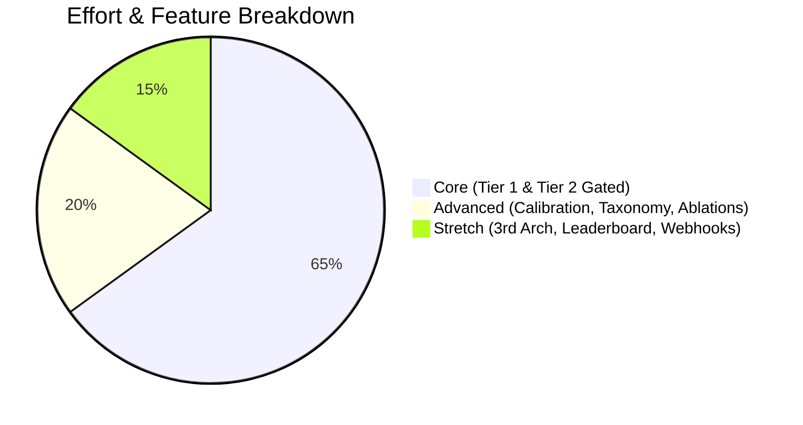

### 1. Minimum Defensible Product (MDP / Core Scope)
*Must be delivered unconditionally for degree completion:*
- Normalized SDK hooks for CrewAI and LangGraph.
- 500+ trace benchmark with known injection labels and clean negative controls.
- Zero-API Semantic Error Diagnostic catching silent errors.
- 3-stage causal attribution pipeline.
- Repair Agent + Controlled Counterfactual Replay.
- Dockerized single-container deployment and 3-screen React dashboard.

### 2. Advanced Features (High Value)
- Confidence calibration curve and Brier score reporting.
- Expansion of fault taxonomy to 3 distinct types (tool corrupt, param swap, context drop).
- Full ablation matrix (SED off, Gate off, Memory off).
- Human-baseline comparative micro-study (accuracy vs. human engineers).

### 3. Stretch & Optional Features (Surplus Time Only)
- 3rd architecture adapter (OpenAI Agents SDK).
- Slack incident alert webhook integration.
- Automated natural-language incident postmortem generation.
- Static public benchmark leaderboard website.

---

# 21. Risks, Technical Challenges & Mitigations

| Risk / Challenge | Severity | What Could Go Wrong | Mitigation & Fallback Strategy |
| :--- | :--- | :--- | :--- |
| **1. AgenTracer Dataset Unavailability** | High | AgenTracer dataset was not publicly released as assumed. | **Solved:** Baseline reproduction switched exclusively to MIT-licensed *Who&When* dataset (in hand). |
| **2. LLM Non-Determinism in Replay** | Medium | Re-running steps produces different outputs, invalidating fix verification. | **Solved:** Replay protocol fixes upstream context, pins temperature to 0, and runs $N=5$ iterations reporting variance. |
| **3. High API / Compute Costs** | High | Evaluating 500+ traces against commercial LLMs could cost hundreds of dollars. | **Solved:** Pre-registered $0 budget; entire pipeline executes against local open-source models via Ollama. |
| **4. Checkpoint Resumption Failure (Tier 2)**| Medium | Resuming execution from mid-workflow checkpoints fails on complex agent states. | **Pre-Registered Fallback:** If Mid-1 gate fails, re-scope to *resumption via controlled replay* (Tier 1). |
| **5. Repair Memory Degradation (Tier 2)** | Medium | Stored repair memory causes accuracy regression on small LLM backbones. | **Pre-Registered Fallback:** If re-test fails, convert feature into an academic *Memory-On vs. Memory-Off Ablation Study*. |
| **6. Overfitting to Test Workflows** | Medium | System works on toy workflows but fails on real user code. | **Mitigation:** Benchmark built on standard real-world task substrates (*tau-bench retail* customer support). |

---

# 22. Missing Information & Recommended Decisions

| Missing Decision in Early Drafts | Why It Matters | Status & Recommended Decision |
| :--- | :--- | :--- |
| **Data Retention Window** | Risk register R16 commits to time-bounded trace retention, but no duration was specified. | **Recommended:** Implement a 30-day default trace retention policy with automated background cleanup. |
| **Agent Name Normalization** | Frameworks name sub-agents differently (e.g., `CrewAgent_1` vs `researcher`), breaking step attribution. | **Recommended:** Adopt the `normalize_agent()` mapping function validated during POC Spike 6 across all adapters. |
| **Exact SED Rule Schema** | How users define custom constraints for their proprietary workflows was initially undefined. | **Recommended:** Implement standard JSONSchema and Pydantic validator definitions for user-supplied task constraints. |
| **WCAG Accessibility Audit** | Dashboard UI needs compliant contrast ratios for university deployment readiness. | **Recommended:** Run automated axe-core/Lighthouse accessibility audits during FYP-2 Week 6 UI polish. |

---

# 23. Conflicts, Contradictions & Historical Resolutions

1. **TracerTraj Dataset Status:**
   - *Document A (Early Drafts):* Stated TracerTraj-2.5K was Apache 2.0 and ready for baseline reproduction.
   - *Document B (Direct Repo Audit):* Proved TracerTraj repo has no LICENSE and only a 127-row sample.
   - *Final Decision [Confirmed]:* Base reproduction on *Who&When* only; downgrade TracerTraj to conditional.
2. **Deterministic Re-execution Claim:**
   - *Document A (Early Plan):* Promised 100% deterministic re-execution of agent steps.
   - *Document B (Audit & Risk R25):* LLM generation is inherently non-deterministic across hardware.
   - *Final Decision [Confirmed]:* Reframe claim: the *replay protocol* is deterministic; LLM variance is measured over $N$ replays.
3. **Number of Mechanisms (14 vs 10 vs 20):**
   - *Document A (Supervisor Review):* Supervisor noted "14 features that map to 1 feature."
   - *Document B (Market Survey Pass):* Merged and structured into **10 foundational items (8 Tier 1 + 2 Tier 2)** with distinct ownership and testable boundaries.
4. **Compute Budget:**
   - *Document A (Cost Estimate):* Outlined paid API options ($353 to $881).
   - *Document B (Final Decision R37):* Committed strictly to **$0 budget** using local Ollama models.

---

# 24. Evolution of the FYP Story

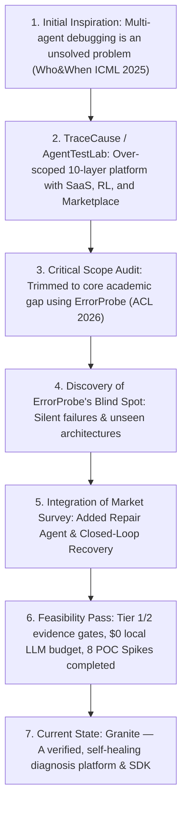

---

# 25. How to Actually Build It (Step-by-Step Execution Guide)

### Step 1: Baseline Trace Normalizer & Schema
- *What to build:* A core Python data model (`TraceNode`, `TraceEdge`, `NormalizedTrace`) using Pydantic.
- *Why:* All three team members need a shared, agreed-upon data contract before writing independent code.
- *Prerequisite:* Python 3.11 environment.
- *Output:* `granite-common` library with serialization/deserialization methods.

### Step 2: Framework Instrumentation Hooks (Shahoud)
- *What to build:* Callback handlers for CrewAI and state listeners for LangGraph.
- *Why:* Automatically capture agent executions into the normalized schema.
- *Prerequisite:* Step 1.
- *Output:* Working `granite-sdk` that outputs valid JSON traces from sample workflows.

### Step 3: Execution Graph Builder & SED Module (Noor)
- *What to build:* NetworkX graph constructor from trace JSON; rule-based constraint validator.
- *Why:* Enable structural traversal and silent-failure detection with 0% LLM cost.
- *Prerequisite:* Step 1 & 2.
- *Output:* Graph generation module returning DAG/cycle models and SED verdicts (`PASS`/`FLAG`).

### Step 4: Causal Attribution Engine (Noor)
- *What to build:* 3-stage Strategist $\rightarrow$ Investigator $\rightarrow$ Arbiter diagnostic pipeline.
- *Why:* Accurately locate the culprit agent and originating step.
- *Prerequisite:* Step 3.
- *Output:* Diagnosis record generator tested against Who&When cases.

### Step 5: Fault Injection Harness & Benchmark Construction (Shahoud)
- *What to build:* Perturbation operators on GSM8K and tau-bench workflows.
- *Why:* Create the 500+ trace evaluation ground truth.
- *Prerequisite:* Step 2.
- *Output:* Labeled benchmark dataset on disk with negative clean controls.

### Step 6: Repair Agent & Controlled Replay Engine (Saif)
- *What to build:* LLM repair generator and sandboxed downstream replay harness ($N=5$).
- *Why:* Close the loop by generating and empirically verifying fixes.
- *Prerequisite:* Step 4.
- *Output:* Measured recovery success rates for diagnosed failures.

### Step 7: Backend API & Database Persistence (Saif)
- *What to build:* FastAPI REST endpoints (`/api/runs`, `/repair`, `/replay`) and PostgreSQL migrations.
- *Why:* Connect the diagnosis engine to a persistent store and external consumers.
- *Prerequisite:* Steps 3, 4, 6.
- *Output:* Running Dockerized backend service.

### Step 8: React Web Dashboard (Saif)
- *What to build:* 3-screen frontend (Run List, Interactive DAG Viewer, Run Detail/Repair Screen).
- *Why:* Provide intuitive visualization for developers and viva defense demonstrations.
- *Prerequisite:* Step 7.
- *Output:* Fully interactive web UI.

### Step 9: System Integration & Evaluation Suite (All)
- *What to build:* Automated evaluation pipeline computing accuracy, F1, recovery rate, and latency.
- *Why:* Generate official research metrics against ErrorProbe baseline.
- *Prerequisite:* All prior steps.
- *Output:* Final evaluation report, ablation tables, and project documentation.

---

# 26. First Week Development Sprint Plan

```text
Day 1: Repo Setup & Data Contract
  ├── Initialize Git repository and pre-commit hooks (Black, Flake8, Pytest)
  ├── Define Pydantic schema for TraceNode, TraceEdge, RunMetadata
  └── Setup local Ollama instance with Llama-3-8B and Qwen models

Day 2: SDK Adapter Prototype (Shahoud) & Backend Scaffolding (Saif)
  ├── Shahoud: Implement basic LangGraph event listener capturing tool inputs/outputs
  ├── Noor: Setup NetworkX graph construction from sample trace JSON
  └── Saif: Initialize FastAPI app with PostgreSQL Docker container and initial migrations

Day 3: Graph Construction & SED Logic (Noor)
  ├── Noor: Implement deterministic SED constraint verifiers for numeric ranges and regex rules
  ├── Shahoud: Implement CrewAI callback hook capturing agent-to-agent message passing
  └── Saif: Build POST /api/runs ingestion endpoint in FastAPI

Day 4: Fault Injection Operator (Shahoud) & Causal Tracer Setup (Noor)
  ├── Shahoud: Implement rule-based tool-output corruption operator on a toy LangGraph workflow
  ├── Noor: Implement BFS backward graph traversal from flagged failure node
  └── Saif: Connect FastAPI ingestion endpoint to PostgreSQL database store

Day 5: Repair Agent & Sandboxed Replay (Saif)
  ├── Saif: Implement prompt-patching logic and test frozen-context replay on Spike 5 toy pipeline
  ├── Noor: Connect local Ollama LLM to Investigator verification stage
  └── Shahoud: Ingest first 20 cases of tau-bench retail dataset

Day 6: Walking Skeleton End-to-End Test (All)
  ├── Run end-to-end flow: Injected Fault → SDK Trace → Graph Build → SED Flag → Attribution → Replay
  └── Verify that all components exchange data cleanly without manual file copying

Day 7: Sprint Review & Dashboard Integration
  ├── Saif: Scaffold React/Vite dashboard connecting to GET /api/runs
  ├── Review test outputs against pre-registered acceptance criteria
  └── Log weekly progress and update AI Usage Log
```

---

# 27. Supervisor Explanation Script

> *"Good afternoon, Dr. Adil. Let us give you a quick, comprehensive briefing on Project **Granite**.*
>
> * **What is our project?**  
>   Granite is an automated debugger and self-healing engine for Multi-Agent AI Systems. It is delivered as an installable Python SDK and web dashboard that monitors AI agent teams, identifies root-cause failures, detects silent errors, and verifies candidate fixes.
>
> * **What problem are we solving?**  
>   When a team of collaborating AI agents fails, determining which agent broke the workflow and at what step is extremely difficult. Furthermore, existing state-of-the-art diagnostic methods like ErrorProbe (ACL 2026) suffer from two major limitations: they are completely blind to 'silent failures' that produce no anomaly signal, and they have never been evaluated on unseen production architectures like CrewAI and LangGraph.
>
> * **What is our proposed solution?**  
>   We build a framework-agnostic platform that normalizes agent traces into execution graphs, runs a zero-cost deterministic Semantic Error Diagnostic to catch silent failures, performs backward causal attribution to find the culprit agent/step, and verifies candidate repairs using controlled counterfactual replay.
>
> * **What are the major modules and team ownership?**  
>   The project is cleanly divided into three independent subsystems:  
>   1. **Shahoud Shahid** owns the *Data & Benchmark Subsystem*—building SDK instrumentation hooks and a 500+ trace fault-injection benchmark.  
>   2. **Muhammad Noor** owns the *Diagnosis Engine*—building execution graph modeling, SED constraint verification, and causal attribution.  
>   3. **Saif Shahzad** owns the *Platform & Recovery Subsystem*—building the counterfactual replay engine, FastAPI backend, PostgreSQL store, and React dashboard.
>
> * **What technologies are we using?**  
>   Python, FastAPI, PostgreSQL, NetworkX, Docker, React, TypeScript, and local open-source LLMs via Ollama—keeping our entire development budget at exactly **$0.00**.
>
> * **What is our research contribution?**  
>   We provide the first cross-framework fault-injection benchmark for multi-agent systems, extend failure attribution beyond anomaly-gated limitations to detect silent errors, and establish empirical recovery verification.
>
> * **How will we evaluate it?**  
>   We evaluate Top-1 Agent and Step Accuracy, Propagation-path F1, Silent Failure Precision/Recall/Coverage, and Recovery Rate against the Who&When benchmark and our new 500+ trace cross-architecture benchmark, with pre-registered statistical confidence intervals and ablation studies.
>
> * **What is our current progress?**  
>   We have already implemented and verified **8 working technical proof-of-concept spikes** on disk, proving the feasibility of attribution, CrewAI instrumentation, silent-failure detection, and counterfactual repair."*

---

# 28. Viva & Defense Question Bank

### Basic & Conceptual Questions
- **Q1: What is a Multi-Agent System (MAS) and why is diagnosing it hard?**  
  *Answer:* A MAS consists of multiple specialized LLM agents collaborating on a task. Diagnosis is difficult because errors cascade: an error introduced by an early agent is transformed or masked by downstream agents, making the visible failure point appear far away from the root cause.
- **Q2: What is a 'Silent Failure'?**  
  *Answer:* A failure where the agent outputs an answer that is grammatically correct, polite, and structurally valid JSON, but factually or mathematically wrong. Standard exception-based monitoring tools miss it because no error code was raised.

### Architecture & Engineering Questions
- **Q3: Why did you choose CrewAI and LangGraph?**  
  *Answer:* They represent two fundamentally different orchestration paradigms (sequential/hierarchical crews vs. cyclic state graphs), are widely used in industry, and were never evaluated in any of the 7 core papers in this literature.
- **Q4: How do you construct the Execution Graph without expensive LLM calls?**  
  *Answer:* We use deterministic structural parsing of message and tool reference identifiers (the GraphTracer method). This approach is 100% deterministic, free of API costs, and runs in milliseconds.

### AI / ML & Research Questions
- **Q5: How does your Semantic Error Diagnostic work without an LLM?**  
  *Answer:* It validates task outputs against machine-checkable constraints (numeric boundaries, regex schemas, retail return policy rules) derived from task specifications. If no formal constraint exists, the system safely *abstains* and reports its coverage rate.
- **Q6: How do you prove your counterfactual replay works if LLMs are non-deterministic?**  
  *Answer:* While LLMs exhibit run-to-run variance, our *replay protocol* is strictly deterministic (frozen upstream context, pinned temperature=0). We re-execute downstream steps $N=5$ times and report the empirical recovery rate and variance rather than relying on a single run.

### Database, Security & Scalability Questions
- **Q7: How do you handle sensitive user data (PII) in traces?**  
  *Answer:* Traces pass through an automated regex-based PII redaction filter before being written to PostgreSQL. Unredacted content is never persisted.
- **Q8: What is your diagnostic latency overhead?**  
  *Answer:* Our target is $<50\%$ wall-clock time overhead relative to the original workflow execution, achieved because graph parsing, SED checking, and causal graph traversal require 0 LLM calls.

---

# 29. "Understand the FYP in One Page" (Cheat Sheet)

```text
========================================================================================
                                 PROJECT GRANITE CHEAT SHEET
========================================================================================
PROJECT TITLE:   A Self-Healing Multi-Agent System for Semantic Error Diagnosis,
                 Verified Repair and Recovery (Code: F26-060-Granite)
SUPERVISOR:      Dr. Muhammad Adil Majeed | Institution: FAST NUCES
TEAM:            Shahoud Shahid (Data/Bench), Muhammad Noor (Diagnosis), Saif Shahzad (Platform)
----------------------------------------------------------------------------------------
THE PROBLEM:     Multi-agent AI systems suffer from cascading failures where errors surface
                 far downstream from the culprit. Existing tools (ErrorProbe) miss silent
                 semantic errors and fail to generalize across agent frameworks.
----------------------------------------------------------------------------------------
THE SOLUTION:    An installable Python SDK + Web Dashboard that captures execution traces,
                 builds dependency graphs, detects silent errors via task constraints (0% API),
                 attributes root-cause agents/steps, and verifies fixes via counterfactual replay.
----------------------------------------------------------------------------------------
SYSTEM MODULES:  1. Data & Benchmark: SDK hooks (CrewAI/LangGraph) + Fault Injection Harness.
                 2. Diagnosis Engine: Graph Builder + Semantic Error Diagnostic + Causal Tracer.
                 3. Platform & Recovery: Repair Agent + Controlled Replay + FastAPI/DB + React UI.
----------------------------------------------------------------------------------------
TECH STACK:      Python, FastAPI, PostgreSQL, React, TypeScript, NetworkX, Docker, Ollama (Llama-3).
----------------------------------------------------------------------------------------
RESEARCH DELTA:  Extends SOTA (ErrorProbe ACL 2026, 59.5% acc) by:
                 1. Catching silent errors via deterministic constraint verification.
                 2. Validating generalization on unseen architectures (CrewAI, LangGraph).
                 3. Verifying candidate repairs via sandboxed counterfactual replay.
----------------------------------------------------------------------------------------
EVALUATION:      Who&When Benchmark (184 cases) + New Cross-Arch Benchmark (500+ traces).
                 Metrics: Top-1 Agent/Step Accuracy, Propagation F1, SED Precision/Recall,
                 Recovery Rate, Diagnostic Overhead (<50%), False Alarm Rate (<5%).
----------------------------------------------------------------------------------------
BUDGET & COST:   $0.00 Committed Budget — 100% executable on local open-source models (Ollama).
----------------------------------------------------------------------------------------
CURRENT STATUS:  8 Technical POC Spikes completed & verified on disk. Scope frozen.
========================================================================================
```

---

# 30. Senior Developer's Practical Recommendation

> ### *"If you were the senior developer leading this FYP, what would you do next?"*
>
> 1. **Baseline the Data Contract on Day 1:** Do not write separate subsystem code until the Pydantic data models for `NormalizedTrace`, `TraceNode`, and `DiagnosisRecord` are committed to `main`. When three developers work on data, algorithms, and UI simultaneously, mismatched JSON keys will destroy weeks of effort.
> 2. **Build the 'Walking Skeleton' First:** Before fine-tuning complex prompts or designing fancy UI animations, connect a 3-node toy LangGraph workflow through the SDK $\rightarrow$ FastAPI $\rightarrow$ Causal Tracer $\rightarrow$ Database $\rightarrow$ React UI. Once a single real trace flows through all layers, the project risk drops by 80%.
> 3. **Protect the $0 Budget Discipline:** Do not be tempted to use paid OpenAI API keys for convenience during development. Keeping the entire pipeline runnable locally on Ollama ensures that the project can be run, evaluated, and defended anywhere, anytime, without unexpected billing failures.
> 4. **Rehearse Subsystem Ownership Out Loud:** Each member must be able to walk through their owned subsystem code and answer the 4 Seoul Accord ownership questions without looking at presentation slides.
