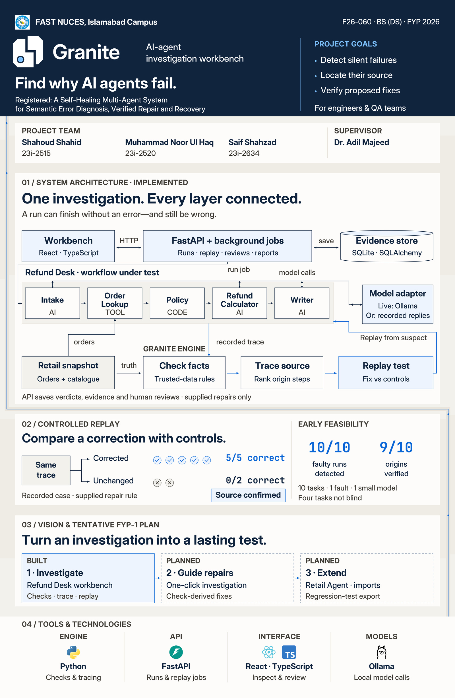

# Granite poster v4.0 — systems and evidence

The main figure now explains Granite itself: workbench, API/jobs, workflow under investigation, model adapter, trusted retail snapshot, investigation engine and stored evidence. Team information is organized into aligned columns. Official technology marks are grouped by role. Recorded replay evidence and the limited pilot share one clear divided panel.

- [Download the complete v4.0 package](granite_poster-package_fyp1-final_v4.0.zip?raw=true)
- [View the full poster](granite_poster-preview_fyp1-final_v4.0.jpg)
- [Print PDF](granite_poster_fyp1-final_v4.0.pdf)
- [Full-resolution JPEG](granite_poster_fyp1-final_v4.0.jpg)
- [Native editable PSD](granite_poster_fyp1-final_v4.0.psd)
- [Live-text SVG for CorelDRAW/vector editing](granite_poster_fyp1-final_v4.0.svg)
- [Standalone architecture PDF](granite_poster-architecture_fyp1-final_v4.0.pdf)
- [Standalone architecture SVG](granite_poster-architecture_fyp1-final_v4.0.svg)
- [Figma import SVG](granite_poster-figma-import_fyp1-final_v4.0.svg)
- [Actual-size text proof](granite_poster-crop-tests_fyp1-final_v4.0.pdf)
- [Actual-size background proof](granite_poster-background-crops_fyp1-final_v4.0.pdf)
- [Handbook checklist](poster-support/v4/handbook-checklist.md)
- [Architecture implementation sources](poster-support/v4/architecture-notes.md)
- [Reference review](poster-support/v4/reference-review.md)
- [Editing guide](poster-support/v4/editing-guide.md)

**Print:** 22.5 × 34.5 inches, portrait. **Raster:** 6750 × 10350 px, 300 ppi, sRGB. **Type:** minimum 26 pt, with embedded PDF fonts matching the live source. **Copy:** 297 conservative tokens / 265 lexical words. **PSD:** 110 native text layers, 11 embedded vector smart objects. **Graphics:** all diagrams and five technology marks are vectors; the university logo is the main PDF's only raster image.

The architecture distinguishes the local retail orders/catalogue from the SQLite/SQLAlchemy investigation database, and AI steps from tool/code steps. Model connections show request/response; controlled replay returns to the suspect step. The API saves verdicts, evidence and human reviews. Current repair rules are supplied by the workflow. No external retailer API, distributed worker fleet, deployed cloud database, arbitrary workflow replay or automatic production repair is invented.

The three plan cards distinguish Built from Planned. One-click investigation, check-derived fixes, Retail Agent, imports and regression-test export are future outcomes from the proposed FYP-1 completion plan. The recorded example and feasibility pilot remain separate, with limitations printed. The removed Early Feasibility date stays removed.

The exact Fault Line logo, DS degree, university identity and quiet Strata and Fault background are retained. The background has separate Base, Strata, Fault channel and Evidence thread groups; the final two background dots are on the right. Geometry is adapted to this revision's gaps. Vendor marks retain their authentic artwork/colours; Python's native mark gradient is retained, with no added poster/background effects.

Four independently editable section sets are in `poster-support/v4/sections`: opening/team, architecture, replay/feasibility and tools/technologies. Each has SVG, PDF and PNG preview formats.

**Before final submission:** print the proofs at Actual size / 100% and check readability from one metre; open the PSD in Photoshop and SVG in CorelDRAW with supplied fonts; confirm printer settings; obtain supervisor approval and submit through the committee's announced channel. Those physical/application/institutional checks remain pending. No unconfirmed bleed was added.

**Figma:** the live file remains at its older revision after previous tool-limit/upload blockers. The package includes a font-independent SVG and a [local importer for 110 live text nodes](poster-support/v4/figma-exhibition-plugin/README.md); the importer passed syntax checks but was not executed or visually verified in Figma.

## Previous files

- [Poster v3.1](granite_poster_fyp1-final_v3.1.pdf)
- [Fault Line logo kit](../../docs/brand/granite-fault-line/README.md)
- [Full compliance audit](../../docs/plan/poster-compliance-audit.md)
