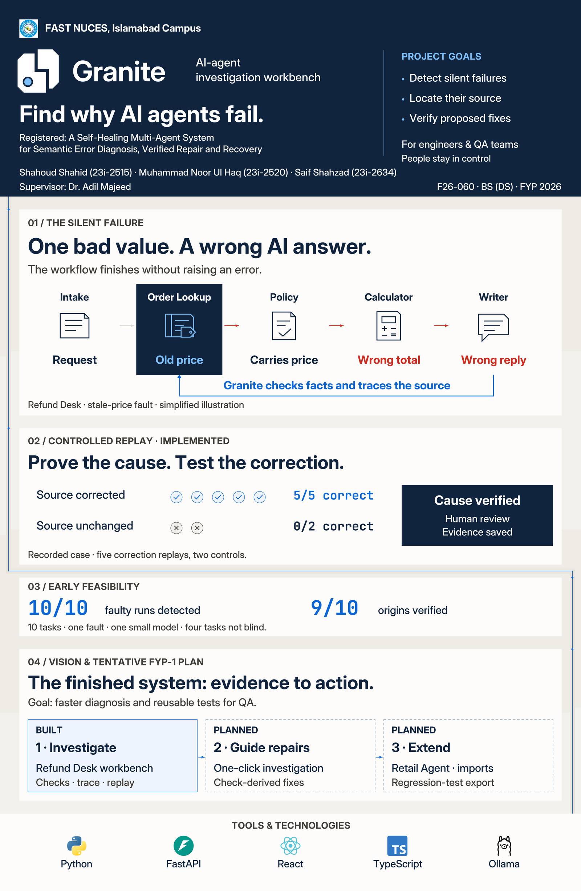

# Granite poster v3.1 — evidence to action

Revision v3.1 removes the date beside Early Feasibility. The rest of the poster is unchanged.

A substantial exhibition redesign: a bold navy header, an illustrated error trail, controlled replay evidence, a clear completion vision and official technology logos. The Fault Line identity and quiet Strata and Fault background are retained.

- [Download the complete v3.1 package](granite_poster-package_fyp1-final_v3.1.zip?raw=true)
- [View the poster](granite_poster-preview_fyp1-final_v3.1.jpg)
- [Print PDF](granite_poster_fyp1-final_v3.1.pdf)
- [Full-resolution JPEG](granite_poster_fyp1-final_v3.1.jpg)
- [Editable PSD](granite_poster_fyp1-final_v3.1.psd)
- [Editable SVG with live text](granite_poster_fyp1-final_v3.1.svg)
- [Figma-ready SVG with outlined vector text](granite_poster-figma-import_fyp1-final_v3.1.svg)
- [Actual-size text crops](granite_poster-crop-tests_fyp1-final_v3.1.pdf)
- [Actual-size margin/gap proof](granite_poster-background-crops_fyp1-final_v3.1.pdf)
- [Handbook checklist](poster-support/v3.1/handbook-checklist.md)
- [Claims, implementation status and sources](poster-support/v3.1/claim-sources.md)
- [Official technology artwork and provenance](poster-support/v3.1/technology-logos/README.md)

The poster replaces the large cash-value comparison with a concrete visual: an old lookup price travels through Policy and Calculator into a wrong reply. The reverse blue path shows Granite checking facts and tracing the source. The next panel compares corrected and unchanged-source replays. The small pilot retains its scope limitations. Planned one-click investigation, check-derived fixes, Retail Agent/imports and regression-test export are distinguished from the implemented workbench. Faster diagnosis is expressly a goal.

**Print trim:** 22.5 × 34.5 inches, portrait. **JPEG/PSD:** 6750 × 10350 px, 300 ppi, sRGB. **Copy:** 238 conservative tokens / 214 lexical words. **Type:** 26 pt minimum; exact Inter Medium/Bold and JetBrains Mono Bold faces embedded in PDF and matched in the live-type source. PDF text is inside a 0.75-inch safe margin and on opaque surfaces. Diagrams and all five technology marks are vectors; the university logo is the only raster asset in the main PDF.

The PSD contains **67 native editable text layers and 11 embedded vector smart objects**. Its bottom **Background** group contains **Base**, **Strata**, **Fault channel**, **Evidence thread** subgroups. **Content panels** sits above it, followed by six content groups. The final two background evidence dots are on the right-hand channel.

**Figma status:** the [linked native Figma poster](https://www.figma.com/design/0OR9RnQzzZCGVfZWOulZ73?node-id=31-3) remains at v2.0. The account's Starter-plan direct-edit tool limit blocked this revision. The package includes a font-independent SVG to drag into Figma and an optional [local native-text importer](poster-support/v3.1/figma-exhibition-plugin/README.md) that builds the new version beside earlier ones. That importer passed syntax/font-name normalization checks but has not been executed or visually verified in Figma.

**Before submission:** print both proof files at Actual size / 100% and read from one metre; open the PSD in Photoshop with the supplied fonts; confirm printer settings; obtain supervisor approval and submit the original source plus JPEG through the committee's announced channel. Digital validation is complete. Physical proof, Photoshop/live Figma application review and institutional approval remain pending. No unconfirmed bleed was added.

## Earlier files and logo kit

- [Poster v3.0](granite_poster_fyp1-final_v3.0.pdf)
- [Poster v2.1](granite_poster_fyp1-final_v2.1.pdf)
- [Fault Line logo kit](../../docs/brand/granite-fault-line/README.md)
- [Full handbook compliance audit](../../docs/plan/poster-compliance-audit.md)
