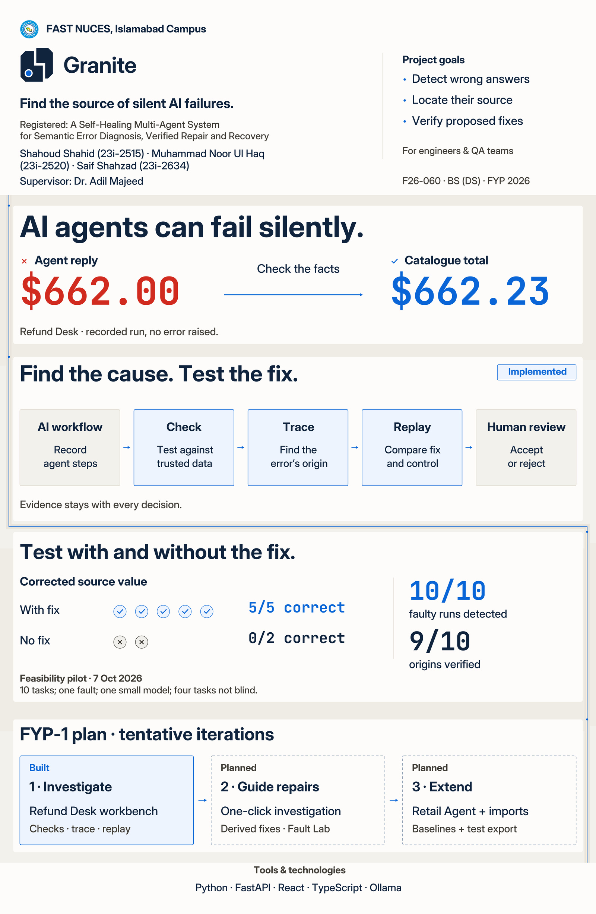

# Granite poster v2.1 — Strata and Fault

The minimal v2 poster with a quiet strata background, stepped evidence thread and opaque content panels. Copy, typography, logo and content positions are preserved. The final two dots follow the right-hand channel.

- [View the updated poster](granite_poster-preview_fyp1-final_v2.1.jpg)
- [Download the v2.1 package](granite_poster-package_fyp1-final_v2.1.zip?raw=true)
- [Print PDF](granite_poster_fyp1-final_v2.1.pdf?raw=true)
- [Full-resolution JPEG](granite_poster_fyp1-final_v2.1.jpg?raw=true)
- [Layered PSD](granite_poster_fyp1-final_v2.1.psd?raw=true)
- [Editable SVG with live text](granite_poster_fyp1-final_v2.1.svg?raw=true)
- [Figma import SVG with font-independent vector text](granite_poster-figma-import_fyp1-final_v2.1.svg?raw=true)
- [Background and opaque panels only](granite_poster-background_fyp1-final_v2.1.svg?raw=true)
- [Actual-size margin and gap print proof](granite_poster-background-crops_fyp1-final_v2.1.pdf)
- [Actual-size text-legibility crops](granite_poster-crop-tests_fyp1-final_v2.1.pdf)
- [Handbook audit and pending checks](poster-support/v2.1/handbook-checklist.md)

**Figma update is pending.** [The original native-text Figma frame](https://www.figma.com/design/0OR9RnQzzZCGVfZWOulZ73?node-id=31-3) remains at v2.0. The direct editor hit the account's Starter-plan call limit; the fallback upload was blocked by this environment. The files linked above contain the completed background design.

To see v2.1 in Figma immediately, download the Figma import SVG and drag it onto the existing poster page. It is all vector except the university logo; its text is outlined for faithful display. To apply the background to the **existing 65 native text nodes**, use the prepared [local Figma updater](poster-support/v2.1/figma-background-plugin/README.md). The updater was syntax-checked but could not be executed in Figma during this task.

Print trim: **22.5 × 34.5 inches, portrait**. JPEG/PSD: **6750 × 10350 px, 300 ppi, sRGB**. Native PSD: **65 live text layers and 11 embedded vector smart objects**. The bottom **Background** group has **Base**, **Strata**, **Fault channel**, **Evidence thread** subgroups; the opaque **Content panels** group sits above it. Minimum font remains **26 pt**; copy remains **218 conservative tokens**. All 65 native text records and their typography/transforms match v2.0.

The older addendum's channel path was adapted to the v2 gaps and symmetric outer margins at the user's request. The light header/footer are retained. All other content is untouched. Full geometry and validation results are in `poster-support`.

Print both proof PDFs at **Actual size / 100%**, with Fit/Shrink disabled. Check faint tones on the actual printer and read the text from one metre before ordering the full print. Photoshop application review, printer bleed/profile confirmation and supervisor approval remain pending. No unconfirmed bleed was added. Install the supplied fonts before live text editing.

## Previous files and logo kit

- [Minimal poster v2.0](granite_poster_fyp1-final_v2.0.pdf)
- [Download v2.0](granite_poster-package_fyp1-final_v2.0.zip?raw=true)
- [Fault Line logo kit](../../docs/brand/granite-fault-line/README.md)
- [Download the logo package](granite_logo-package_fyp1-final_v1.0.zip?raw=true)
- [Poster v1.1](granite_poster_fyp1-final_v1.1.pdf)
