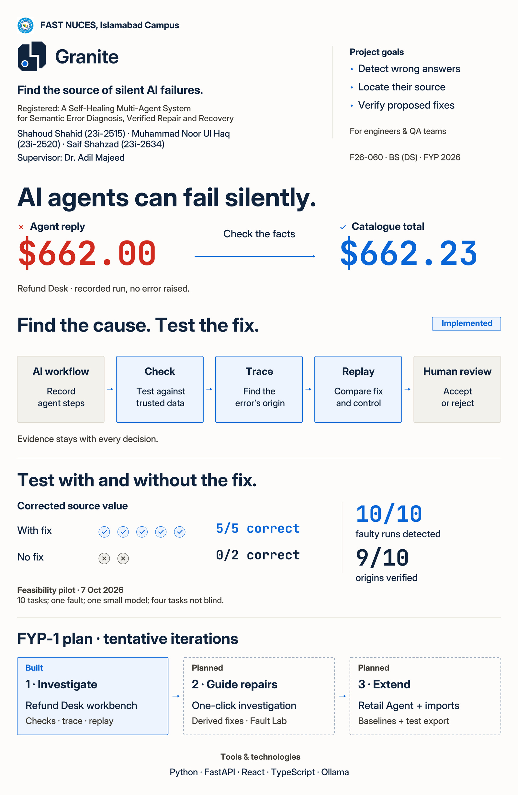

# Granite poster v2.0 — maximum clarity

A new, simpler research poster with the Fault Line logo, a five-block workflow, real replay evidence and a tentative iteration plan.

- [Open the editable Figma poster](https://www.figma.com/design/0OR9RnQzzZCGVfZWOulZ73?node-id=31-3)
- [Download all v2.0 files](granite_poster-package_fyp1-final_v2.0.zip?raw=true)
- [View the poster preview](granite_poster-preview_fyp1-final_v2.0.jpg)
- [Download the print PDF](granite_poster_fyp1-final_v2.0.pdf?raw=true)
- [Download the full-resolution JPEG](granite_poster_fyp1-final_v2.0.jpg?raw=true)
- [Download the layered PSD](granite_poster_fyp1-final_v2.0.psd?raw=true)
- [Open the editable SVG](granite_poster_fyp1-final_v2.0.svg)
- [Print the A4 crop tests at 100%](granite_poster-crop-tests_fyp1-final_v2.0.pdf)
- [Review handbook compliance and pending physical checks](poster-support/v2/handbook-checklist.md)

**218 words/tokens, down from 479 (54.5% fewer).** No text below 26 pt. The poster retains the exact registered title, BS (DS), team and supervisor, top-right goals, intended users, institutional identity, tools and technologies, and a bottom plan with developed outcomes per iteration. Implemented and planned work are visibly separated.

Print size: **22.5 × 34.5 inches, portrait**. JPEG: 6750 × 10350 px, 300 ppi, sRGB. PSD: 65 live text layers and six embedded vector smart objects. Figma: 65 editable text nodes and 60 vector nodes; its only raster asset is the university logo.

The master is a native Photoshop-compatible PSD, generated programmatically. Install the supplied fonts before editing. Application compatibility, physical one-metre legibility, printer settings and supervisor approval remain to be checked before final submission.

This redesign follows the handbook and the team's latest simplicity brief. The old design prompt's exact point sizes and pixel coordinates are superseded. The handbook itself does not mandate numerical font sizes, particular typefaces, a fixed word count, screenshots, bleed or a CMYK profile.

## Logo kit and previous review

- [Fault Line logo kit](../../docs/brand/granite-fault-line/README.md)
- [Download the logo package](granite_logo-package_fyp1-final_v1.0.zip?raw=true)
- [Previous poster v1.1](granite_poster_fyp1-final_v1.1.pdf)
