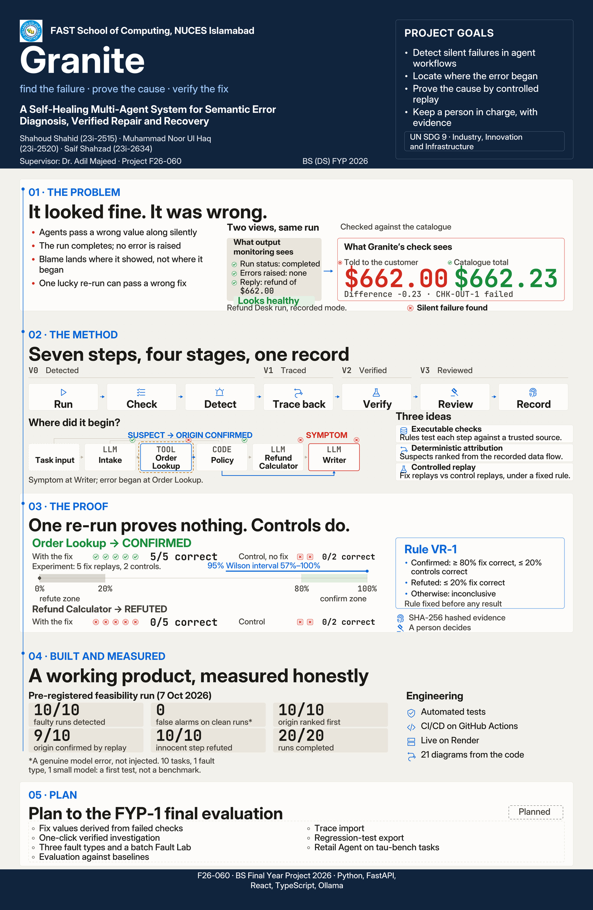

# Granite FYP-1 Final — poster review v1.1

The poster degree label is **BS (DS)**, corrected at the team's request on 13 November 2026.

- [Open the editable poster in Figma](https://www.figma.com/design/0OR9RnQzzZCGVfZWOulZ73?node-id=3-2)
- [Download the complete poster package](granite_poster-package_fyp1-final_v1.1.zip?raw=true)
- [View the poster preview](granite_poster-preview_fyp1-final_v1.1.jpg)
- [Download the full-resolution JPEG](granite_poster_fyp1-final_v1.1.jpg?raw=true)
- [Download the layered PSD master](granite_poster_fyp1-final_v1.1.psd?raw=true)
- [Open the vector PDF](granite_poster_fyp1-final_v1.1.pdf)
- [Open the editable SVG source](granite_poster_fyp1-final_v1.1.svg)
- [Print the A4 crop tests at 100% scale](granite_poster-crop-tests_fyp1-final_v1.1.pdf)
- [Read the production handoff and outstanding print checks](poster-support/print-review.md)

The print master is 22.5 × 34.5 inches, portrait, with a 6750 × 10350-pixel sRGB JPEG at 300 ppi. The PSD contains 146 live text layers and seven embedded PDF vector smart objects. The Figma version contains 146 editable text nodes and editable vector diagrams; its only raster image is the university logo. The poster has 479 whitespace-separated tokens and no printed text below 22 pt.

This is a **review draft**. The original brief's incompatible typography and geometry required documented layout adjustments; Photoshop application review, printer settings, and supervisor approval remain pending. See the handoff before printing or university submission. The archive includes fonts and OFL licences under `poster-support/fonts/`.

The stage also hosts the FYP-1 Final report, slides and panel demonstration deliverables as they become available. Poster creation does not mark the evaluation stage or planned features complete.

## Fault Line logo kit

- [Download all logo assets](granite_logo-package_fyp1-final_v1.0.zip?raw=true)
- [Open the one-page usage sheet](../../docs/brand/granite-fault-line/granite-logo-usage.pdf)
- [Browse the editable SVG, PDF, transparent PNG, favicon and avatar assets](../../docs/brand/granite-fault-line/README.md)
- [Open the editable Figma logo gallery](https://www.figma.com/design/0OR9RnQzzZCGVfZWOulZ73?node-id=24-3)
