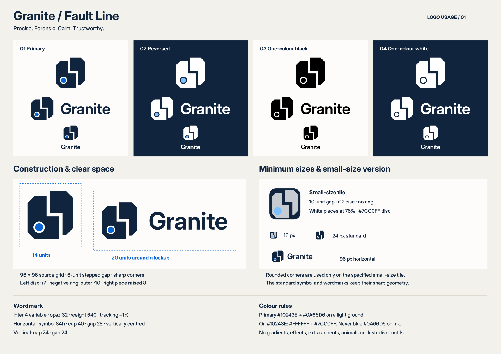

# Granite — Fault Line logo kit v1.0

The mark is built from the supplied 96 × 96 coordinates. The standard stepped gap is 6 units. Its origin ring is a real transparent cutout, with an independent 7-unit coloured disc inside the left piece. No freehand redrawing, gradients, glows, shadows or extra accent colours are used.

[Editable Figma logo gallery](https://www.figma.com/design/0OR9RnQzzZCGVfZWOulZ73?node-id=24-3)



## Deliverables

- `svg/`: editable standard mark, horizontal and vertical combination logos in primary, reversed, black and white. The standard files expose named `left`, `right`, `ring`, and `disc` SVG layers. The ring layer controls a vector negative-space clip; it is not white artwork. The `wordmark` layer contains editable vector outlines, preserving the exact Inter 4 shape without a font dependency.
- `svg/*-live-text.svg`: optional live-wordmark horizontal and vertical sources. Install the supplied Inter 4 variable font to edit these. Their live text specifies `opsz=32`, `wght=640`, and −1% letter spacing.
- `pdf/`: 13 one-page vector artwork PDFs, with no embedded raster images. White and reversed artwork is transparent; place it on the ink background shown in the usage sheet.
- `png/`: 36 transparent sRGB PNGs: every standard colourway and layout at 512 / 1024 / 2048 px. The named size is the longest canvas edge: square for marks, width for horizontal lockups, height for vertical lockups. Lockup exports include their 20-unit clear-space zone; standard marks retain the supplied 96-unit source artboard.
- `favicons/`: SVG, a multi-resolution ICO containing the exact checked 16/32/48/64 PNG images, PNG sizes 16/24/32/48/64/180/192/512, Apple touch icon, and a web manifest.
- `avatar/granite-avatar-1024.png`: 1024 × 1024 avatar using the small-size ink tile.
- `granite-logo-usage.pdf`: one-page A3 landscape sheet showing every variation, 14-unit symbol and 20-unit lockup clear space, the small-size version and all minimum sizes. Also supplied as editable SVG and a PNG preview.
- `proofs/`: actual-size 16/24/96 px proofs and an enlarged pixel contact sheet.
- `fonts/`: Inter 4.001 variable, the exact opsz32/wght640 instance used to generate the outlines, and the SIL OFL licence. Only install the variable font if you need live-wordmark editing; the outline assets work without installed fonts.
- `source/geometry.json`: the standard and small-size polygon coordinates and all measured construction values.
- `source/validation.json`: geometry, transparency, colour, font, PDF, PNG and favicon checks.
- `source/build-logo.py` and `source/verify-logo.py`: production and verification scripts.

## Construction and use

The standard left and right polygons are unchanged from the brief, including all four 12-unit 45° outer chamfers and the right piece's 8-unit rise. The small version moves only the gap boundaries two units outward on each side, producing 10-unit separation; it has no ring and uses the specified r12 disc at (26,70).

The horizontal mark has 84 units of visible height. The wordmark's font cap metric is exactly 40 units; the gap is 28, measured between visible symbol and wordmark ink bounds. The wordmark is centred vertically using its actual ink bounds. The vertical lockup has a 24-unit cap height and a 24-unit gap between visible symbol and wordmark bounds. Glyph overshoot is retained rather than distorted.

Reserve at least 14 source units outside the visible symbol and 20 outside a lockup, including when cropping or placing the PNGs. Minimum sizes: 16 px for the small-size tile, 24 px for the standard symbol, 96 px width for a horizontal lockup. Never place primary blue `#0A66D6` on ink `#10243E`; use the reversed light-blue disc `#7CC0FF` there.

The rounded 20-unit tile is used **only** for the explicitly specified small-size version, favicons and avatar. All standard outer corners and the stepped gap remain sharp.

The 16 px small version, 24 px monochrome/reversed symbols and both full-size combinations were inspected visually. The one-page sheet was also checked. These are digital rendering checks.

## Rebuilding

Install Python dependencies `fonttools`, `uharfbuzz`, `cairosvg`, `Pillow`, and `PyMuPDF`, and install the supplied Inter font for the usage-sheet labels. From this folder, run:

```bash
python source/build-logo.py --font fonts/inter-4-variable.ttf --output ../granite-logo-rebuilt
python source/verify-logo.py --root ../granite-logo-rebuilt
```

The wordmark outlines are shaped with HarfBuzz from the exact Inter 4 variable font instance, including font kerning and −0.01 em tracking. The diagrams and all artwork in the PDFs remain vectors.

Created 13 November 2026 for Granite, project F26-060. This kit supplies branding assets; it does not change the poster's content or complete its pending timeline/print-approval checks.
