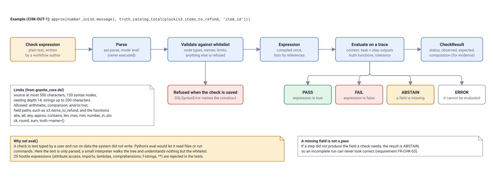
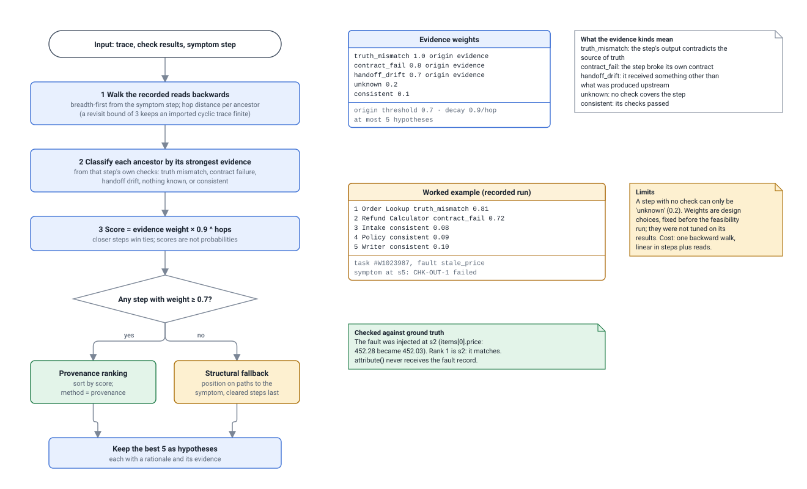
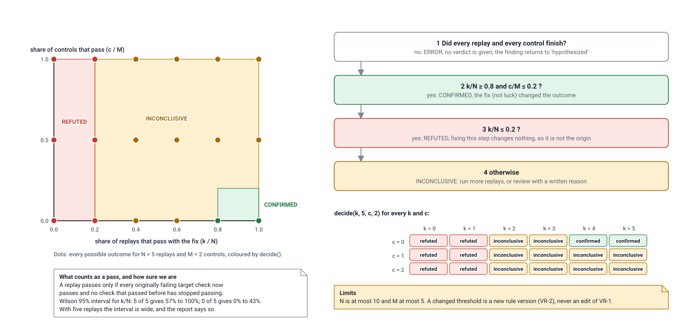
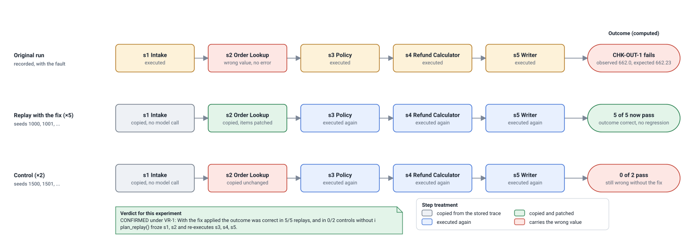

# Data structure and algorithm design

Generated by `python scripts/build_design_pack.py` from the code. Do not edit by hand: change the code or `scripts/design_pack/`, then rebuild. CI fails if this file is out of date.

Granite has four algorithms worth designing: evaluating a check safely, ranking where a failure began, verifying that ranking by controlled replay, and deciding the verdict. Each has a diagram below; the data structures and pseudocode follow. Constants, thresholds and the worked examples in the diagrams are read from the code and from a recorded run when this page is built.

## Check language: from text to result

*Handbook Table 1a item: Data Structure and Algorithm Design.*

The check language is the first of Granite's three core algorithms. A check is stored as text and turned into a syntax tree once; a validator walks the tree and accepts only whitelisted node types, a fixed set of function names and bounded sizes. Evaluation is a recursive interpreter over that tree with two inputs: the context (the task and every step's outputs) and the workflow's source-of-truth functions. Every operand, resolved field and truth call is kept in the result, which is why a failed check can be shown and re-computed as evidence. Complexity is linear in the number of syntax nodes (at most 150).



- **Drawn from:** [`packages/granite_core/granite_core/dsl.py`](../../packages/granite_core/granite_core/dsl.py), [`packages/granite_core/granite_core/checks.py`](../../packages/granite_core/granite_core/checks.py), [`packages/granite_core/tests/test_dsl.py`](../../packages/granite_core/tests/test_dsl.py), [`docs/adr/adr-004-ast-check-dsl.md`](../../docs/adr/adr-004-ast-check-dsl.md)
- **Kept true by:** Limits, the function list and the example expression are read from the code when the pack is built.

## Attribution: ranking where a failure began

*Handbook Table 1a item: Data Structure and Algorithm Design.*

Attribution answers 'where did the wrong value first appear'. It uses two data structures: the lineage graph (steps as nodes, declared reads as edges, stored inside each trace) and the list of check results. It walks the graph backwards from the step where the symptom showed, labels every ancestor with the strongest evidence its own checks provide, and scores by weight and distance. Only if no ancestor carries origin-grade evidence does it fall back to graph position. The worked example on the right is not illustrative: it is the output of attribute() on a recorded run, recomputed at build time and compared with the injected fault.



- **Drawn from:** [`packages/granite_core/granite_core/attribution.py`](../../packages/granite_core/granite_core/attribution.py), [`packages/granite_core/granite_core/lineage.py`](../../packages/granite_core/granite_core/lineage.py), [`packages/granite_core/tests/test_attribution.py`](../../packages/granite_core/tests/test_attribution.py), [`docs/adr/adr-005-provenance-first-attribution.md`](../../docs/adr/adr-005-provenance-first-attribution.md), [`data/cassettes/refund_desk_v1.json`](../../data/cassettes/refund_desk_v1.json)
- **Kept true by:** Weights, threshold, decay and the hypothesis limit are read from the module; the worked example and its comparison with ground truth are computed from the recorded run.

## Verdict rule VR-1

*Handbook Table 1a item: Data Structure and Algorithm Design.*

VR-1 is the answer to the panel's question about how a flaw is verified. The chart shows the whole rule: the horizontal axis is how often the outcome became correct when the suspected step was fixed, the vertical axis how often it became correct without the fix. Only the bottom-right corner is a confirmation: the fix works and the controls stay broken. The dots are the 18 possible outcomes of the default experiment and the table below repeats them as text; both are produced by calling the real decide() function, so the picture and the code cannot disagree. The rule is checked in order, and an unfinished experiment never yields a verdict.



- **Drawn from:** [`packages/granite_core/granite_core/verification.py`](../../packages/granite_core/granite_core/verification.py), [`packages/granite_core/tests/test_verification.py`](../../packages/granite_core/tests/test_verification.py), [`docs/adr/adr-006-vr1-verdict-rule.md`](../../docs/adr/adr-006-vr1-verdict-rule.md)
- **Kept true by:** Thresholds, limits, every dot and every table cell are computed by calling decide() and wilson() when the pack is built.

## Replay plan: fix one step, keep everything before it

*Handbook Table 1a item: Data Structure and Algorithm Design.*

Verification is a controlled experiment on a stored trace. The planner splits the steps at the suspected one: everything up to and including it is copied from the trace without calling a model, and only the later steps run again. In a replay with the fix the suspected step's output is patched with the value its repair rule computes; in a control it is left as it was. Different seeds are used so that a pass cannot be a lucky repetition. The outcome column is real: it is the result of running this experiment on the recorded example when the pack is built.



- **Drawn from:** [`packages/granite_core/granite_core/verification.py`](../../packages/granite_core/granite_core/verification.py), [`packages/granite_core/granite_core/runner.py`](../../packages/granite_core/granite_core/runner.py), [`packages/granite_core/granite_core/experiment.py`](../../packages/granite_core/granite_core/experiment.py), [`workflows/refund_desk/refund_desk/definition.py`](../../workflows/refund_desk/refund_desk/definition.py), [`data/cassettes/refund_desk_v1.json`](../../data/cassettes/refund_desk_v1.json)
- **Kept true by:** The frozen and re-executed steps come from plan_replay(), the patched field from the workflow's repair rule, and the counts and verdict from run_experiment() on the recorded run.

## Data structures

| Structure | Defined in | Shape | Why this shape, and what it costs |
|---|---|---|---|
| Trace | `granite_core/trace.py` | Ordered list of steps; each step lists the `step.field` values it read | The list is the execution order and the reads are an adjacency list, so one document is both the record and the lineage graph. Finding a step by id is one dictionary lookup |
| Lineage graph | `granite_core/lineage.py` | Edge list `(source step, target step, field)` derived from the reads; an index from target to incoming edges | Built in one pass over the steps; walking backwards from a symptom visits each step and edge at most a bounded number of times |
| Compiled check | `granite_core/dsl.py` | Validated syntax tree plus the list of fields it references | Validated once when saved, then evaluated many times; evaluation visits each of at most 150 nodes once |
| Check result | `granite_core/checks.py` | Status, observed, expected, and the full computation (operands, resolved fields, truth calls) | Keeping the computation makes a result re-computable and usable as evidence without re-running the workflow |
| Finding lifecycle | `granite_core/lifecycle.py` | Dictionary `(status, event) -> status` | A transition is one lookup; anything not in the dictionary is illegal by construction, with no scattered `if` chains |
| Replay plan | `granite_core/verification.py` | Two lists (frozen steps, steps to re-execute) and a patch dictionary | Makes explicit which steps cost no model call; the patch is data, so it can be stored, hashed and shown |
| Cassette | `granite_core/llm.py` | Dictionary from the SHA-256 of a request (model, messages, parameters, seed) to the recorded answer; one JSON file | Constant-time lookup; the same request always gives the same answer, which makes runs and tests reproducible offline |
| Evidence record | `granite_core/evidence.py` | Payload plus the SHA-256 of its canonical JSON | Any reader can recompute the hash; a changed payload is detected on every read |
| Job | `apps/api/granite_api/jobs.py`, table `jobs` | A database row per job and a small thread pool | Progress survives a page reload, and after a restart unfinished jobs are closed instead of hanging |
| Rate limit window | `apps/api/granite_api/main.py` | Per-client queue of timestamps from the last 60 seconds | Sliding window in memory; enough for one process, stated as a limit in the defect list |

## The four algorithms in pseudocode

### 1. Evaluating a check

```
evaluate_check(check, trace, truth):
    if check is disabled: skip
    expression = compile(check.expression)        # parse and whitelist-validate; refused text never gets here
    try:
        outcome = expression.evaluate(context(trace), truth, check.tolerance)
    except a referenced field is missing:          return ABSTAIN
    except the expression cannot be evaluated:     return ERROR
    if outcome.value is not a boolean:             return ERROR
    return PASS if outcome.value else FAIL, with observed, expected and the full computation
```

Cost: linear in the syntax nodes of the expression (at most 150), for each of the workflow's checks.

### 2. Ranking where a failure began

```
attribute(trace, results, symptom_step):
    distance = breadth-first walk backwards over the recorded reads from symptom_step
    for each step reached:
        kind  = strongest evidence from that step's own check results
                (truth_mismatch > contract_fail > handoff_drift > unknown > consistent)
        score = WEIGHTS[kind] * DECAY ** distance[step]
    if any step has WEIGHTS[kind] >= ORIGIN_THRESHOLD:
        rank by score                               # method "provenance"
    else:
        rank by position on the paths to the symptom, cleared steps last   # method "structural"
    return the best MAX_HYPOTHESES, each with a rationale and its evidence
```

Cost: one backward walk, linear in steps plus reads, and a sort of at most a few dozen steps. The function receives the trace and the check results only; the injected-fault record is not a parameter.

### 3. Verifying a hypothesis

```
run_experiment(workflow, trace, step, N, M, target_checks):
    fix  = build_intervention(trace, step, workflow.repairs[step])    # no rule: stop, "cannot be verified"
    plan = plan_replay(trace, fix)                                    # frozen = steps up to `step`; replay = the rest
    for i in 1..N:  replay with the fix applied,   seed = base + i
    for j in 1..M:  replay without it (control),    seed = base + 500 + j
    each replay: copy frozen steps from the trace, re-execute the rest, re-run all checks,
                 pass = every target check passes and no previously passing check now fails
    return summarize(passes with fix, passes of controls, N, M)
```

Cost: dominated by model calls, `(N + M) x (model steps after the suspected step)`; nothing before the suspected step is executed again.

### 4. Deciding the verdict (VR-1)

```
decide(k, N, c, M):
    if a replay or control did not finish:   ERROR
    if k/N >= 0.8 and c/M <= 0.2:            CONFIRMED
    if k/N <= 0.2:                           REFUTED
    otherwise:                               INCONCLUSIVE
```

Constant time. The Wilson 95% interval for `k/N` is reported with every verdict.
