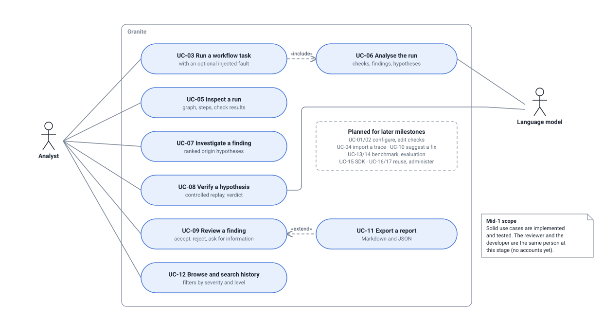
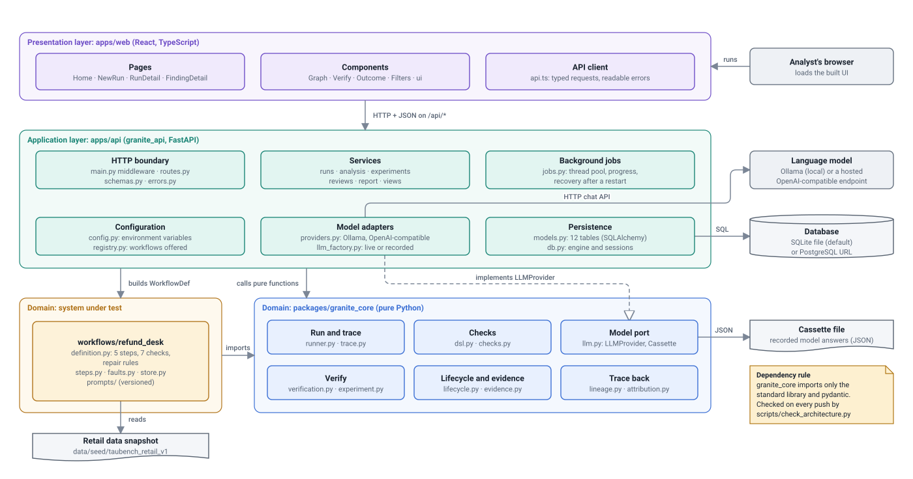
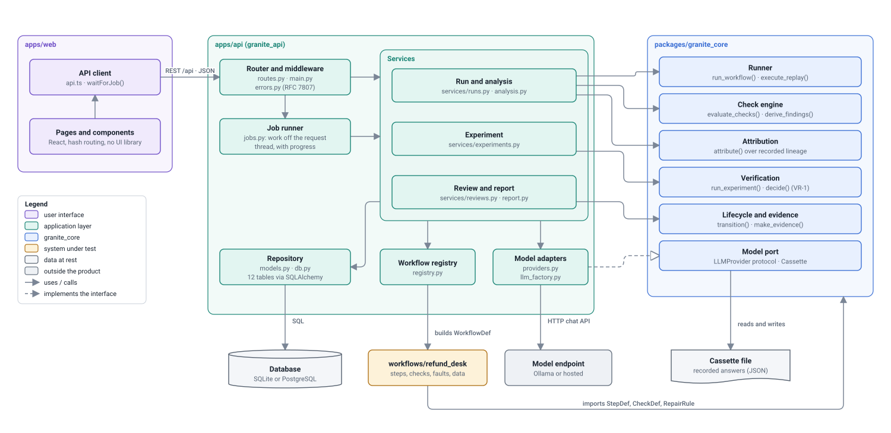
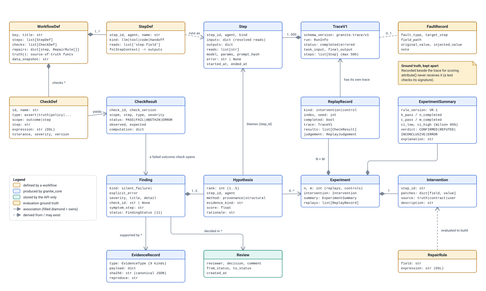
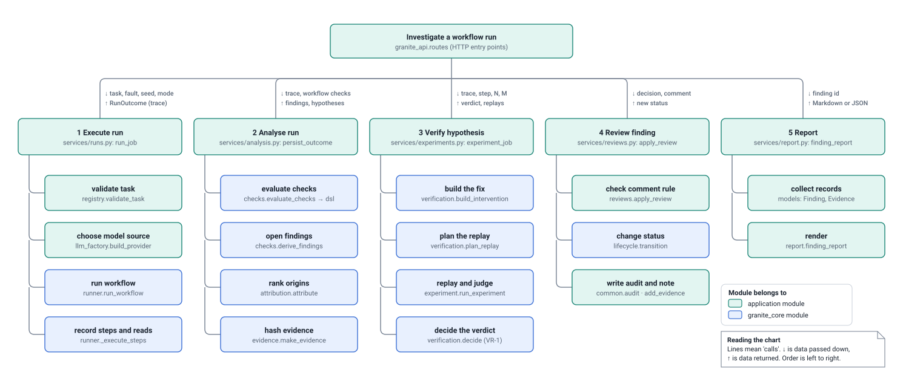
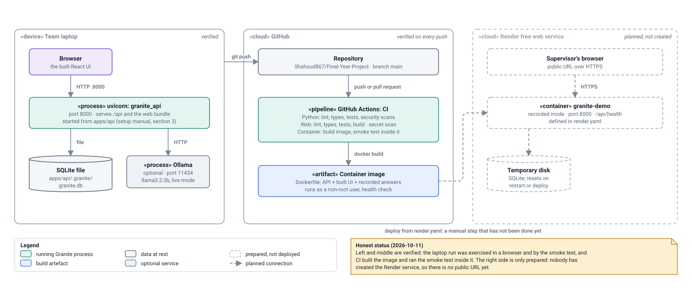

# Architecture and structure design

Generated by `python scripts/build_design_pack.py` from the code. Do not edit by hand: change the code or `scripts/design_pack/`, then rebuild. CI fails if this file is out of date.

Structure design for Iteration 1 (handbook Table 1a): use cases, layers, components, the domain model, the structure chart and the deployment diagram. Decisions behind them are recorded in [`docs/adr/`](../adr/).

## Use-case diagram (Mid-1 scope)

*Handbook Table 1a item: Use Cases / Use Case Diagram.*

The identifiers are those of the requirements (master plan section 15). Eight use cases are implemented for Mid-1; the dashed box lists the ones deliberately left for later. Running a task always includes the automatic analysis (UC-06), which is why a finding appears without a separate request. Exporting a report extends reviewing: it is offered on the finding page at any time. The language model is a secondary actor in exactly two use cases, running and verifying.

- **Drawn from:** [`docs/plan/master-plan.md`](../../docs/plan/master-plan.md), [`docs/plan/requirements-trace.md`](../../docs/plan/requirements-trace.md), [`apps/web/src/pages`](../../apps/web/src/pages)
- **Kept true by:** Curated from the use-case table of the plan; implementation status follows docs/plan/requirements-trace.md.

## Layer diagram

*Handbook Table 1a item: Layer Diagram.*

Granite has four layers and dependencies point downward only. The web UI talks to the API over HTTP and knows nothing about the engine. The API layer owns everything with side effects (HTTP, database, threads, network calls to a model). The domain layer is split in two: the Refund Desk workflow (the system being investigated) and granite_core, which decides what is wrong, where it began and whether a diagnosis is proven. The core has no web, database or network code, which is why its 207 tests run in seconds; the API plugs a model into it by implementing the core's LLMProvider interface (dependency inversion).

- **Drawn from:** [`apps/web/src`](../../apps/web/src), [`apps/api/granite_api`](../../apps/api/granite_api), [`workflows/refund_desk/refund_desk`](../../workflows/refund_desk/refund_desk), [`packages/granite_core/granite_core`](../../packages/granite_core/granite_core), [`docs/adr/adr-001-modular-monolith.md`](../../docs/adr/adr-001-modular-monolith.md)
- **Kept true by:** Layout is curated. The dependency rule it shows is enforced mechanically by scripts/check_architecture.py.

## Component diagram

*Handbook Table 1a item: Component Diagram.*

Each box is a deployable or replaceable part. The browser part only knows the REST interface. Inside the API, the router validates and delegates, the job runner executes long work (a run takes about a minute with a local model) and reports progress, and three services hold the use cases. Services call the core through plain functions named in the blue boxes; the core never calls back. Two parts are deliberately replaceable: the model adapter implements the core's LLMProvider interface, so a local model, a hosted model or recorded answers can be swapped by configuration, and a workflow is plugged in through the registry as a WorkflowDef.

- **Drawn from:** [`apps/api/granite_api/routes.py`](../../apps/api/granite_api/routes.py), [`apps/api/granite_api/services`](../../apps/api/granite_api/services), [`apps/api/granite_api/jobs.py`](../../apps/api/granite_api/jobs.py), [`apps/api/granite_api/registry.py`](../../apps/api/granite_api/registry.py), [`apps/api/granite_api/providers.py`](../../apps/api/granite_api/providers.py), [`packages/granite_core/granite_core`](../../packages/granite_core/granite_core), [`apps/web/src/api.ts`](../../apps/web/src/api.ts)
- **Kept true by:** Curated layout. Every arrow from a service to a core component corresponds to an import that the generated call graph shows function by function.

## Domain model (class diagram)

*Handbook Table 1a item: Domain Model / Class Diagram.*

Read it left to right. A workflow definition (yellow) declares steps, the reads between them, checks and repair rules. Running it produces a TraceV1 made of recorded Steps. Evaluating a CheckDef on a trace yields a CheckResult; a failed outcome check opens a Finding. Attribution attaches up to five ranked Hypotheses to the finding, each blaming one recorded step. An Experiment verifies one hypothesis: an Intervention (built from a RepairRule) patches that step, N+M ReplayRecords each carry their own trace, and the ExperimentSummary holds the VR-1 verdict. EvidenceRecords and Reviews hang off the finding. The FaultRecord is deliberately off to the side: it exists only to score the analysis.

- **Drawn from:** [`packages/granite_core/granite_core/runner.py`](../../packages/granite_core/granite_core/runner.py), [`packages/granite_core/granite_core/trace.py`](../../packages/granite_core/granite_core/trace.py), [`packages/granite_core/granite_core/checks.py`](../../packages/granite_core/granite_core/checks.py), [`packages/granite_core/granite_core/attribution.py`](../../packages/granite_core/granite_core/attribution.py), [`packages/granite_core/granite_core/verification.py`](../../packages/granite_core/granite_core/verification.py), [`packages/granite_core/granite_core/experiment.py`](../../packages/granite_core/granite_core/experiment.py), [`packages/granite_core/granite_core/evidence.py`](../../packages/granite_core/granite_core/evidence.py), [`apps/api/granite_api/models.py`](../../apps/api/granite_api/models.py)
- **Kept true by:** Every field name shown is checked against the real class when the pack is built; a renamed or removed field fails the build. Relationships and layout are curated.

## Structure chart

*Handbook Table 1a item: Structure Chart.*

The chart shows who calls whom at module level and what travels on each call. The API entry points do no work themselves: they hand a run to module 1, whose result (a trace) is the only input module 2 needs. Verification (module 3) starts again from the stored trace, not from the run, which is what makes a replay possible days later. Modules 1 to 3 each end in a call into granite_core (blue): the application modules only add validation, persistence and state changes around them.

- **Drawn from:** [`apps/api/granite_api/services/runs.py`](../../apps/api/granite_api/services/runs.py), [`apps/api/granite_api/services/analysis.py`](../../apps/api/granite_api/services/analysis.py), [`apps/api/granite_api/services/experiments.py`](../../apps/api/granite_api/services/experiments.py), [`apps/api/granite_api/services/reviews.py`](../../apps/api/granite_api/services/reviews.py), [`apps/api/granite_api/services/report.py`](../../apps/api/granite_api/services/report.py)
- **Kept true by:** Curated; the function names are the real ones and are cross-checked by the generated call graph.

## Deployment diagram

*Handbook Table 1a item: Deployment Diagram.*

There is one deployable unit: a container image that holds the API, the built web UI and the recorded model answers, so it runs with no model server and no key. Today that software runs in two verified places: on a team laptop as a single uvicorn process, and inside GitHub Actions, where every push builds the image and runs an end-to-end smoke test in it. A hosted copy on a free web service is prepared (render.yaml) but has not been created; the dashed elements show that plan and must not be read as existing.

- **Drawn from:** [`Dockerfile`](../../Dockerfile), [`docker-compose.yml`](../../docker-compose.yml), [`render.yaml`](../../render.yaml), [`.github/workflows/ci.yml`](../../.github/workflows/ci.yml), [`docs/registers/deployment-record.md`](../../docs/registers/deployment-record.md), [`evidence/repo/2026-10-09_ci-run-37924480165.md`](../../evidence/repo/2026-10-09_ci-run-37924480165.md)
- **Kept true by:** Curated. Ports, modes and file locations are the defaults in apps/api/granite_api/config.py and the Dockerfile.
