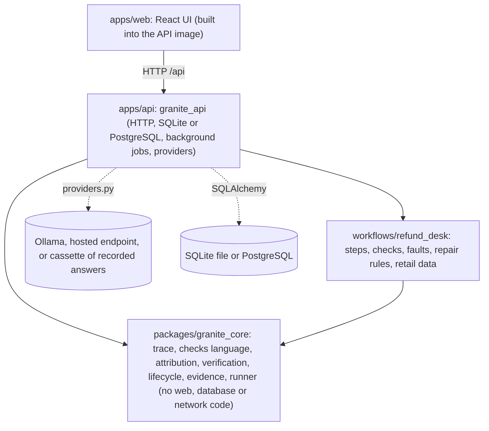
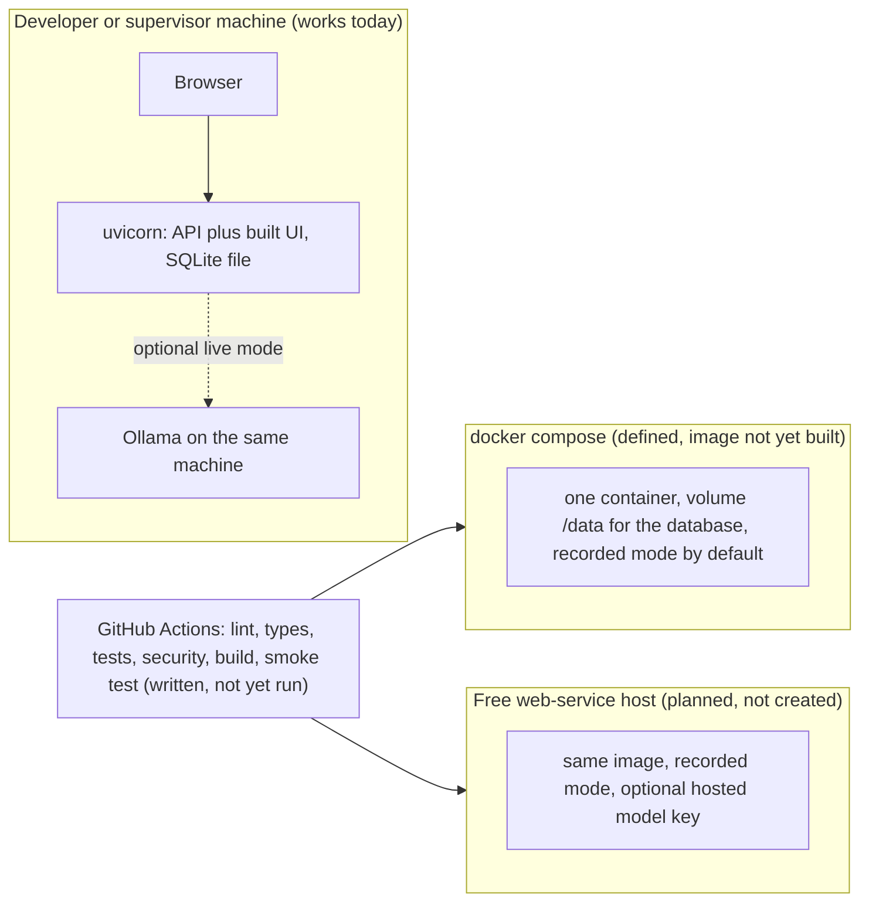

# Architecture

One repository, four packages, one dependency direction (arrows point from the dependent to the dependency). See [ADR-001](../adr/adr-001-modular-monolith.md).

| Layer | May import | Must not import |
|---|---|---|
| `granite_core` | standard library, pydantic | fastapi, sqlalchemy, httpx, urllib, any workflow |
| `refund_desk` | `granite_core` | the API, any web or database library |
| `granite_api` | core, refund_desk, fastapi, sqlalchemy | UI code |

The rule is checked by what the core's dependency list contains (`pydantic` only) and by its tests running without a network or a database.

## Deployment

Only the first two rows exist today. Nothing is hosted ([deployment record](../registers/deployment-record.md), [ADR-007](../adr/adr-007-free-hosting-render.md)).

