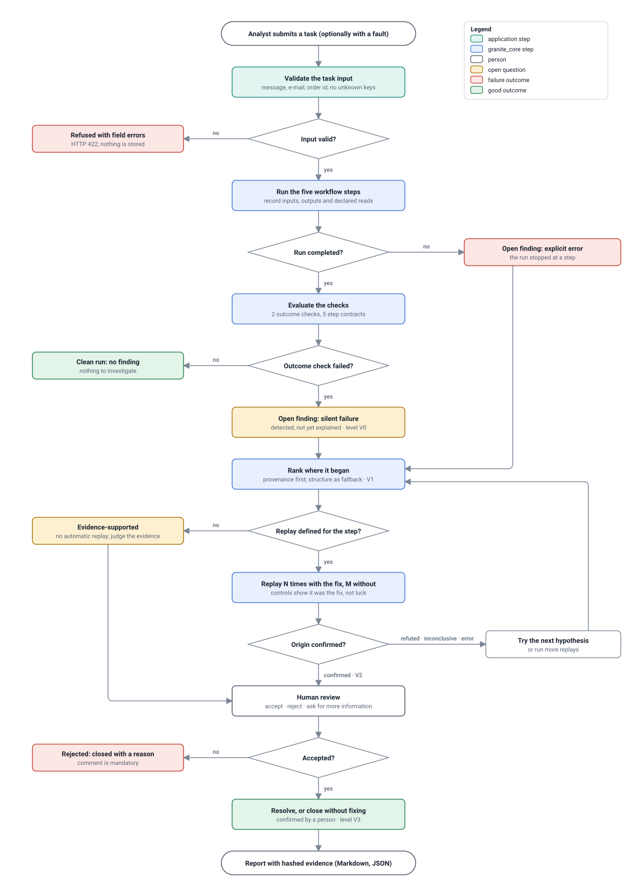
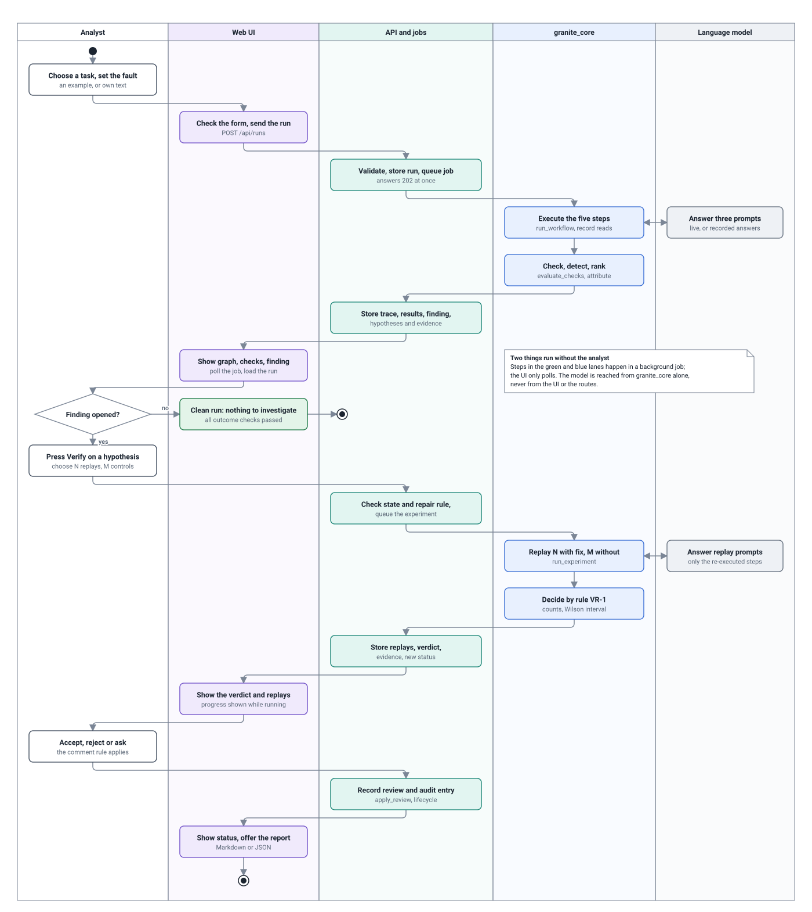
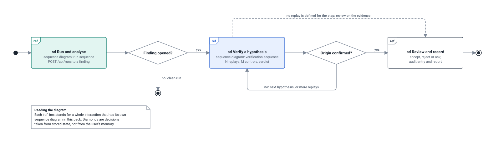
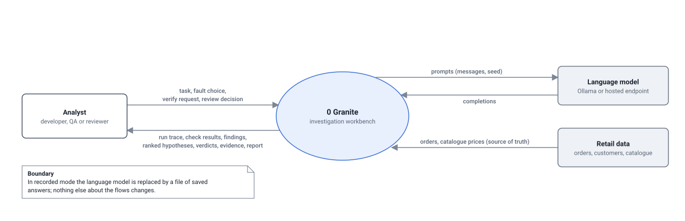
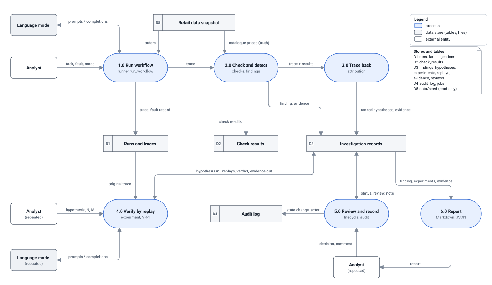
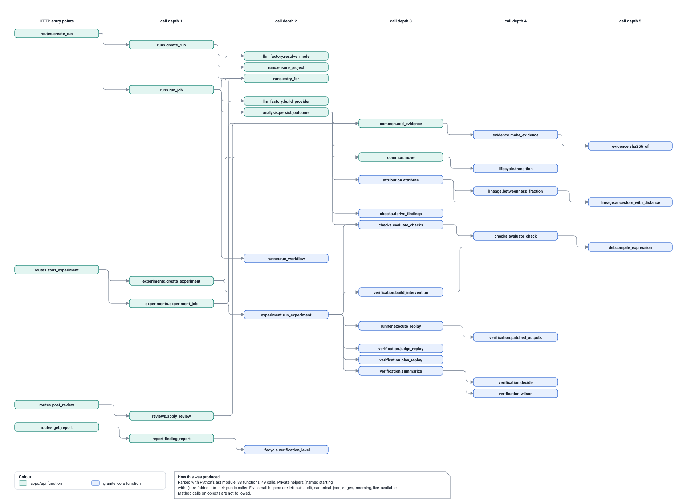

# Behaviour design

Generated by `python scripts/build_design_pack.py` from the code. Do not edit by hand: change the code or `scripts/design_pack/`, then rebuild. CI fails if this file is out of date.

How the system behaves: the investigation flow, an activity diagram with responsibilities, the interaction overview, data flow at two levels, and the call graph computed from the source. The state machine, the lineage graph and the sequence diagrams have their own pages, linked from [`design-pack.md`](design-pack.md).

## Investigation flow

*Handbook Table 1a item: Flow Diagram.*

The flowchart is the product's one workflow, the answer to the panel's request to redefine it. It has six decision points and each one has a visible outcome in the UI. Two findings are possible: an explicit error (the run stopped) and a silent failure (the run finished but an outcome check failed). Ranking comes before proof, and proof is optional only when no replay is defined for the suspected step, in which case the finding is marked evidence-supported and a person judges it. A refuted or inconclusive result loops back to the ranked list rather than ending the investigation.

- **Drawn from:** [`apps/api/granite_api/services/runs.py`](../../apps/api/granite_api/services/runs.py), [`apps/api/granite_api/services/analysis.py`](../../apps/api/granite_api/services/analysis.py), [`apps/api/granite_api/services/experiments.py`](../../apps/api/granite_api/services/experiments.py), [`apps/api/granite_api/services/reviews.py`](../../apps/api/granite_api/services/reviews.py), [`packages/granite_core/granite_core/checks.py`](../../packages/granite_core/granite_core/checks.py)
- **Kept true by:** Curated. The statuses it names are the states of the generated state machine.

## Activity diagram: one investigation

*Handbook Table 1a item: Activity Diagram.*

Each lane is a responsibility, and the diagram shows that the analyst acts only three times: to start a run, to ask for verification and to decide. Everything between those actions is automatic and happens in a background job, which is why the UI lane only sends a request and then displays results. The language model is used in exactly two activities, both started from the core. The decision 'Finding opened?' is where a clean run ends; there is no path from a clean run to a review.

- **Drawn from:** [`apps/web/src/pages`](../../apps/web/src/pages), [`apps/api/granite_api/routes.py`](../../apps/api/granite_api/routes.py), [`apps/api/granite_api/jobs.py`](../../apps/api/granite_api/jobs.py), [`apps/api/granite_api/services`](../../apps/api/granite_api/services), [`packages/granite_core/granite_core`](../../packages/granite_core/granite_core)
- **Kept true by:** Curated. The activities are the modules of the structure chart and the messages of the two sequence diagrams.

## Interaction overview diagram

*Handbook Table 1a item: Interaction Overview Diagram.*

An investigation is three conversations between the analyst and the system, and this diagram shows their order. The first always happens. The second happens only if a finding was opened, and may repeat: each pass verifies one hypothesis. The third needs either a confirmed origin or, when the workflow defines no replay for the suspected step, the evidence alone. Because the decisions are stored states, the analyst can stop after any box and continue another day.

- **Drawn from:** [`apps/api/granite_api/routes.py`](../../apps/api/granite_api/routes.py), [`packages/granite_core/granite_core/lifecycle.py`](../../packages/granite_core/granite_core/lifecycle.py)
- **Kept true by:** Curated; each 'ref' names a sequence diagram of this pack.

## Data flow diagram: context (level 0)

*Handbook Table 1a item: Data Flow Diagram (DFD).*

At context level Granite has three neighbours. The analyst supplies a task and decisions and receives everything needed to judge a run. The language model is the only non-deterministic neighbour; it receives prompts and returns text, and can be replaced by recorded answers. The retail data plays two roles on purpose: the workflow's tool step reads orders from it, and the checks read catalogue prices from it independently, which is what lets a stale tool answer be detected.

- **Drawn from:** [`apps/api/granite_api/routes.py`](../../apps/api/granite_api/routes.py), [`apps/api/granite_api/providers.py`](../../apps/api/granite_api/providers.py), [`workflows/refund_desk/refund_desk/store.py`](../../workflows/refund_desk/refund_desk/store.py)
- **Kept true by:** Curated; the level-1 diagram refines the single process.

## Data flow diagram: level 1

*Handbook Table 1a item: Data Flow Diagram (DFD).*

The top row is what happens automatically after a task is submitted: run, check, trace back. The bottom row is what a person starts later: verify, review, report. The two rows share only stored data, which is the reason a verification can be run on a trace recorded earlier. Process 4 never reads the fault record in D1, and process 3 never reads it either: the injected fault is kept only to score the analysis. The note on the right maps each store to real tables.

- **Drawn from:** [`apps/api/granite_api/services`](../../apps/api/granite_api/services), [`apps/api/granite_api/models.py`](../../apps/api/granite_api/models.py), [`packages/granite_core/granite_core`](../../packages/granite_core/granite_core)
- **Kept true by:** Curated; process names are the modules of the structure chart and the stores are the tables of the ER diagram.

## Call graph (computed from the source)

*Handbook Table 1a item: Call Graph or Sequence Diagram.*

The graph answers 'what code runs when I press this button'. Its four roots are the HTTP handlers for running a task, verifying a hypothesis, recording a review and exporting a report. Colours show the architecture holding: green application functions sit on the left and call blue core functions to their right, and no blue function ever calls a green one. Select a function in the interactive pack to highlight exactly what it calls and what calls it.

- **Drawn from:** [`apps/api/granite_api/routes.py`](../../apps/api/granite_api/routes.py), [`apps/api/granite_api/jobs.py`](../../apps/api/granite_api/jobs.py), [`apps/api/granite_api/llm_factory.py`](../../apps/api/granite_api/llm_factory.py), [`apps/api/granite_api/registry.py`](../../apps/api/granite_api/registry.py), [`apps/api/granite_api/services/runs.py`](../../apps/api/granite_api/services/runs.py), [`apps/api/granite_api/services/analysis.py`](../../apps/api/granite_api/services/analysis.py), [`apps/api/granite_api/services/experiments.py`](../../apps/api/granite_api/services/experiments.py), [`apps/api/granite_api/services/reviews.py`](../../apps/api/granite_api/services/reviews.py), [`apps/api/granite_api/services/report.py`](../../apps/api/granite_api/services/report.py), [`apps/api/granite_api/services/common.py`](../../apps/api/granite_api/services/common.py), [`packages/granite_core/granite_core/runner.py`](../../packages/granite_core/granite_core/runner.py), [`packages/granite_core/granite_core/checks.py`](../../packages/granite_core/granite_core/checks.py), [`packages/granite_core/granite_core/dsl.py`](../../packages/granite_core/granite_core/dsl.py), [`packages/granite_core/granite_core/attribution.py`](../../packages/granite_core/granite_core/attribution.py), [`packages/granite_core/granite_core/lineage.py`](../../packages/granite_core/granite_core/lineage.py), [`packages/granite_core/granite_core/verification.py`](../../packages/granite_core/granite_core/verification.py), [`packages/granite_core/granite_core/experiment.py`](../../packages/granite_core/granite_core/experiment.py), [`packages/granite_core/granite_core/lifecycle.py`](../../packages/granite_core/granite_core/lifecycle.py), [`packages/granite_core/granite_core/evidence.py`](../../packages/granite_core/granite_core/evidence.py)
- **Kept true by:** Fully computed: 38 functions and 49 call edges extracted from 19 source files by static analysis every time the pack is built.
