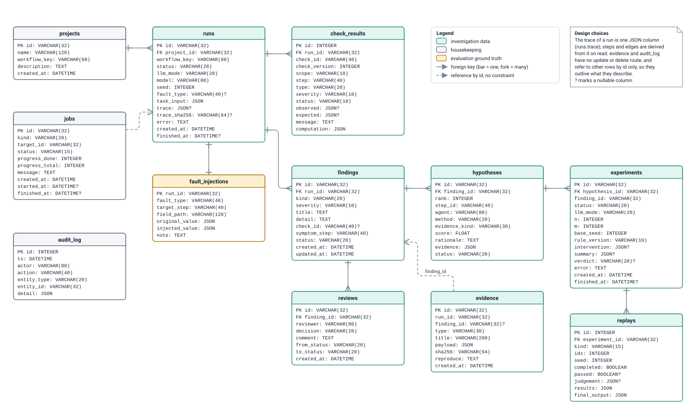

# Database schema

Generated by `python scripts/build_design_pack.py` from the code. Do not edit by hand: change the code or `scripts/design_pack/`, then rebuild. CI fails if this file is out of date.

The ER diagram of the twelve tables. Column-by-column meanings, the trace document, request inputs and enumerations are in the [data dictionary](data-dictionary.md).

## Database schema (ER diagram)

*Handbook Table 1a item: Schema Design / ER Diagram.*

Read it as a chain: a project has runs; a run has check results, at most one injected-fault record, and findings; a finding has ranked hypotheses and reviews; a hypothesis has experiments; an experiment has replays. Evidence hangs off findings by id without a foreign key on purpose: evidence and the audit log are append-only and must survive the rows they describe. The fault record (yellow) is kept in its own table so that no analysis query can read it by accident. The full column meanings are in the data dictionary.

- **Drawn from:** [`apps/api/granite_api/models.py`](../../apps/api/granite_api/models.py), [`apps/api/granite_api/db.py`](../../apps/api/granite_api/db.py), [`docs/adr/adr-003-persistence-sqlalchemy.md`](../../docs/adr/adr-003-persistence-sqlalchemy.md)
- **Kept true by:** Tables, columns, types, nullability, keys and foreign keys are read from the SQLAlchemy metadata when the pack is built; a new table, column or foreign key fails the build until the drawing and dictionary are updated.
