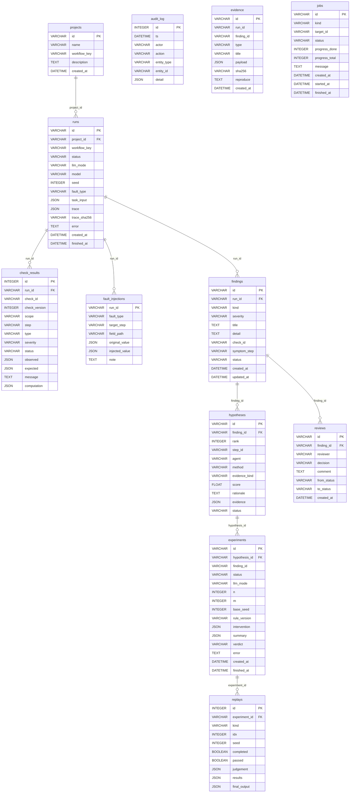

# Database schema

Generated by `python scripts/export_diagrams.py` from the code. Do not edit by hand; a CI check fails if it drifts.

Evidence and audit rows are append-only (the API has no update or delete route for them). The canonical trace of a run is the JSON column `runs.trace`; steps and graph edges are derived from it ([ADR-003](../adr/adr-003-persistence-sqlalchemy.md)). `evidence` and `audit_log` carry ids without foreign keys on purpose, so they outlive the rows they describe.

