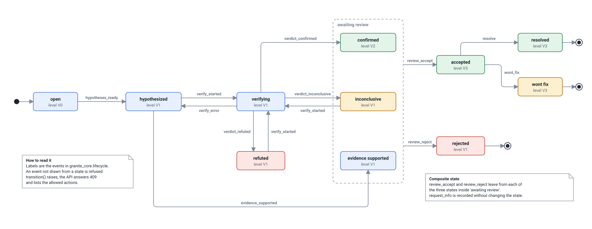

# Finding state machine

Generated by `python scripts/build_design_pack.py` from the code. Do not edit by hand: change the code or `scripts/design_pack/`, then rebuild. CI fails if this file is out of date.

Every change of a finding's status goes through `granite_core.lifecycle.transition`; an event that is not drawn from a state is refused and the API answers 409 with the allowed actions.

## Finding state machine

*Handbook Table 1a item: Network Automata / Graphs or State Machine.*

A finding moves through eleven states and nothing can skip a step: it cannot be accepted before it was verified or supported by evidence, and it cannot be resolved before a person accepted it. Verification can end three ways; a refuted or inconclusive result leads back to verifying (the next hypothesis, or more replays), and a technical failure returns to 'hypothesized' instead of inventing a verdict. The level under each state (V0 to V3) is computed from the state. Reaching 'evidence supported' happens automatically when the first-ranked step has strong provenance evidence but no replay is defined for it.

- **Drawn from:** [`packages/granite_core/granite_core/lifecycle.py`](../../packages/granite_core/granite_core/lifecycle.py), [`apps/api/granite_api/services/common.py`](../../apps/api/granite_api/services/common.py), [`apps/api/granite_api/services/reviews.py`](../../apps/api/granite_api/services/reviews.py), [`packages/granite_core/tests/test_lifecycle_evidence_redaction_llm.py`](../../packages/granite_core/tests/test_lifecycle_evidence_redaction_llm.py)
- **Kept true by:** States, events, targets and levels are read from granite_core.lifecycle when the pack is built. If a transition is added or removed in the code, the build fails until the drawing is updated.
