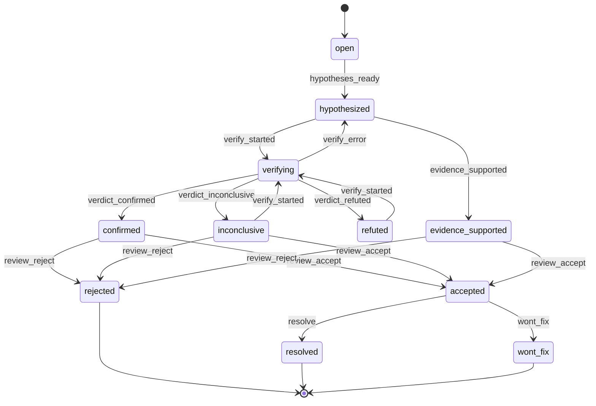

# Finding state machine

Generated by `python scripts/export_diagrams.py` from the code. Do not edit by hand; a CI check fails if it drifts.

Every change of a finding's status goes through `granite_core.lifecycle.transition`; an event that is not listed here for the current status raises an error and the API answers 409 with the allowed actions. The levels V0 to V3 follow from the status (`verification_level`).

