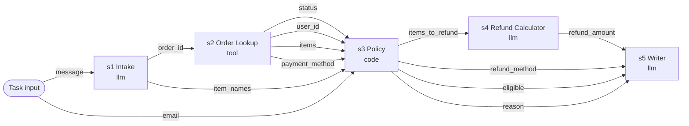

# Refund Desk data flow

Generated by `python scripts/export_diagrams.py` from the code. Do not edit by hand; a CI check fails if it drifts.

Edges are the `reads` each step declares; the runner records them and attribution walks them backwards. A stale price enters at s2 and travels s2 to s3 to s4 to s5.

## Checks

- `CHK-OUT-1` (outcome, truth) on s5: Stated refund equals the catalogue total of the refunded items
- `CHK-OUT-2` (outcome, policy) on s3: Refund decision follows policy (delivered order owned by the customer)
- `CT-INTAKE` (step, assert) on s1: Intake kept the order id and found items
- `CT-LOOKUP` (step, truth) on s2: Lookup prices match the catalogue
- `CT-POLICY` (step, assert) on s3: Refunded items carry the prices the lookup reported
- `CT-CALC` (step, assert) on s4: Refund equals the sum of the prices the calculator received
- `CT-WRITER` (step, assert) on s5: Message states the computed refund
