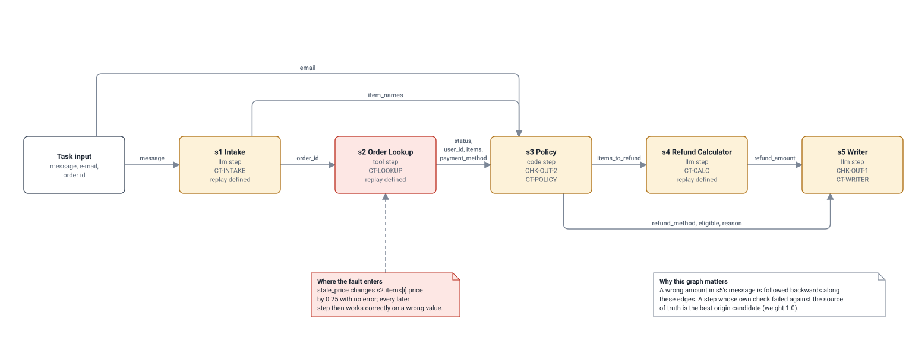

# Refund Desk data lineage

Generated by `python scripts/build_design_pack.py` from the code. Do not edit by hand: change the code or `scripts/design_pack/`, then rebuild. CI fails if this file is out of date.

The data-flow graph of the system under test. Its edges are the reads each step declares; the runner records them with every run and attribution walks them backwards.

## Lineage graph of the Refund Desk

*Handbook Table 1a item: Network Automata / Graphs or State Machine.*

This is the data-lineage graph of the system under test, drawn from the reads each step declares in refund_desk/definition.py. The runner records these edges with every run, and attribution walks them backwards from the step where the symptom appeared. Under each step are the checks attached to it, and 'replay defined' marks the steps for which the workflow gives a repair rule, so a hypothesis blaming them can be verified by replay. The red step is where the built-in fault is injected.

- **Drawn from:** [`workflows/refund_desk/refund_desk/definition.py`](../../workflows/refund_desk/refund_desk/definition.py), [`workflows/refund_desk/refund_desk/faults.py`](../../workflows/refund_desk/refund_desk/faults.py), [`packages/granite_core/granite_core/lineage.py`](../../packages/granite_core/granite_core/lineage.py)
- **Kept true by:** Fully generated: steps, edges, field names, checks per step, repair rules and the fault target are read from the workflow definition when the pack is built.
