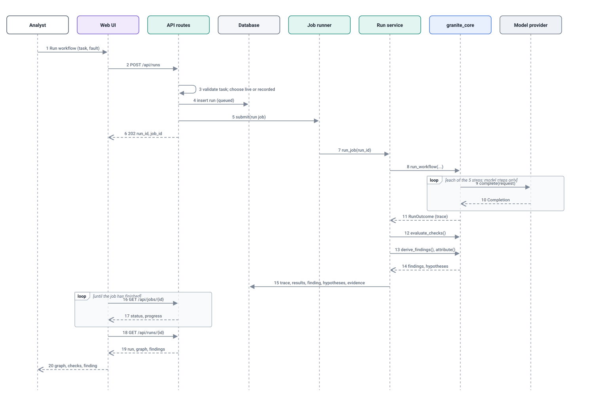
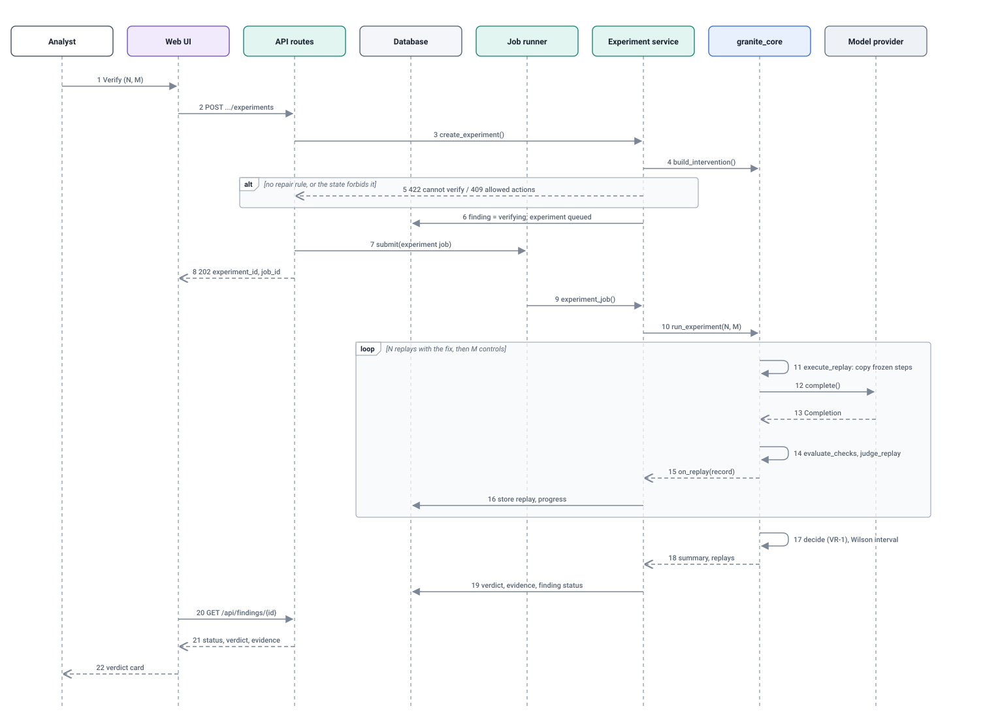

# Sequence diagrams

Generated by `python scripts/build_design_pack.py` from the code. Do not edit by hand: change the code or `scripts/design_pack/`, then rebuild. CI fails if this file is out of date.

The two interactions that matter most: running a task up to a finding, and verifying a hypothesis up to a verdict.

## Sequence diagram: run and analyse

*Handbook Table 1a item: Call Graph or Sequence Diagram.*

The request returns at message 6, before any model is called: a run with a local model takes about a minute, so the work is handed to the job runner and the browser polls for progress (messages 17 and 18). The model is called only inside the loop, by the core, through the provider interface. Analysis (messages 13 to 15) happens in the same job, immediately after the run, and everything is written in one transaction (message 16): a run is never visible without its check results.

- **Drawn from:** [`apps/api/granite_api/routes.py`](../../apps/api/granite_api/routes.py), [`apps/api/granite_api/services/runs.py`](../../apps/api/granite_api/services/runs.py), [`apps/api/granite_api/services/analysis.py`](../../apps/api/granite_api/services/analysis.py), [`apps/api/granite_api/jobs.py`](../../apps/api/granite_api/jobs.py), [`packages/granite_core/granite_core/runner.py`](../../packages/granite_core/granite_core/runner.py), [`apps/web/src/pages/NewRun.tsx`](../../apps/web/src/pages/NewRun.tsx)
- **Kept true by:** Curated from the code paths; the function names appear in the generated call graph, and the journey is exercised by apps/api/tests/test_journeys.py and tests/system.

## Sequence diagram: verify a hypothesis

*Handbook Table 1a item: Call Graph or Sequence Diagram.*

Two refusals happen before any model call (message 5): a step with no repair rule cannot be replayed, and a finding in the wrong state cannot be verified. Inside the loop, message 12 is the reason replays are cheap and exact: steps up to the suspected one are copied from the stored trace, and only later steps run again, each replay with its own seed. Every replay is stored as it finishes (message 17), so progress is visible and a failure half-way keeps the completed replays. The verdict (message 18) is computed once, by a fixed rule, after all replays.

- **Drawn from:** [`apps/api/granite_api/services/experiments.py`](../../apps/api/granite_api/services/experiments.py), [`packages/granite_core/granite_core/experiment.py`](../../packages/granite_core/granite_core/experiment.py), [`packages/granite_core/granite_core/runner.py`](../../packages/granite_core/granite_core/runner.py), [`packages/granite_core/granite_core/verification.py`](../../packages/granite_core/granite_core/verification.py), [`apps/web/src/components/Verify.tsx`](../../apps/web/src/components/Verify.tsx)
- **Kept true by:** Curated from the code paths; the same calls appear in the generated call graph and the flow is covered by packages/granite_core/tests/test_experiment.py.
