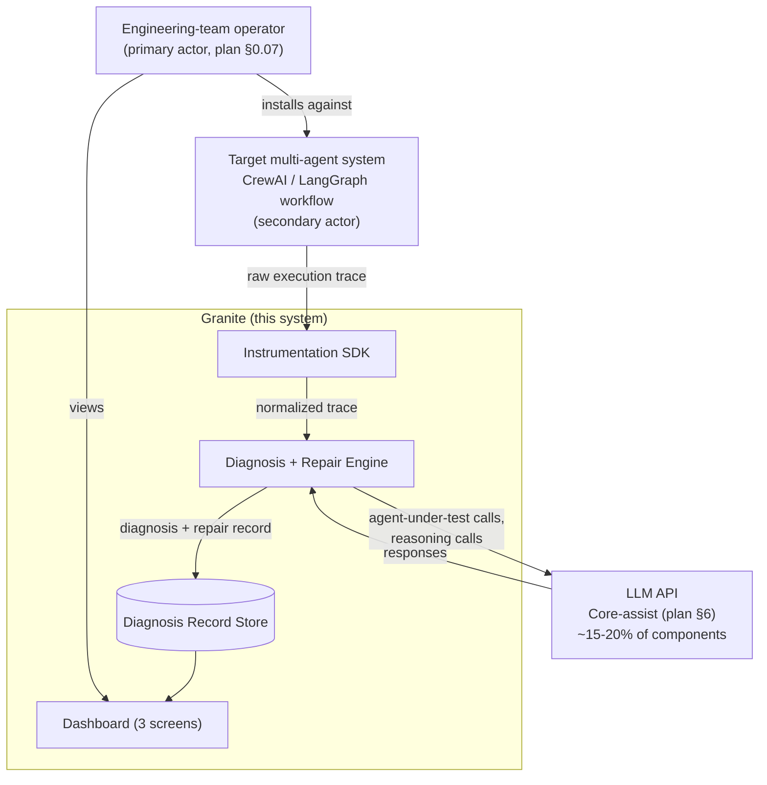
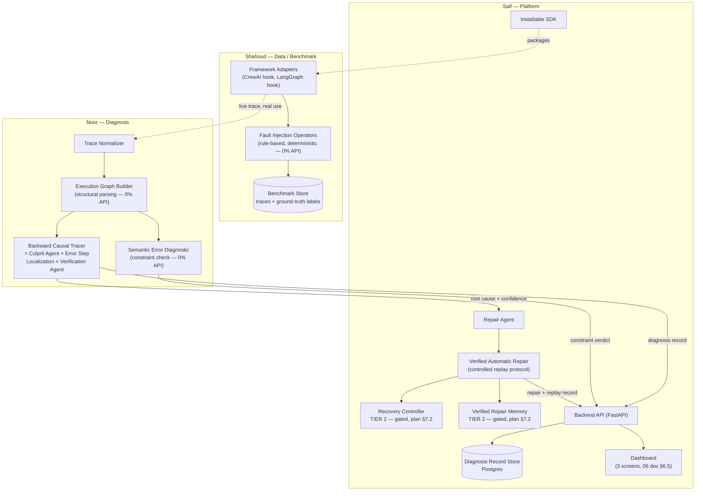
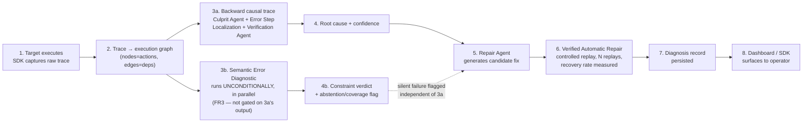
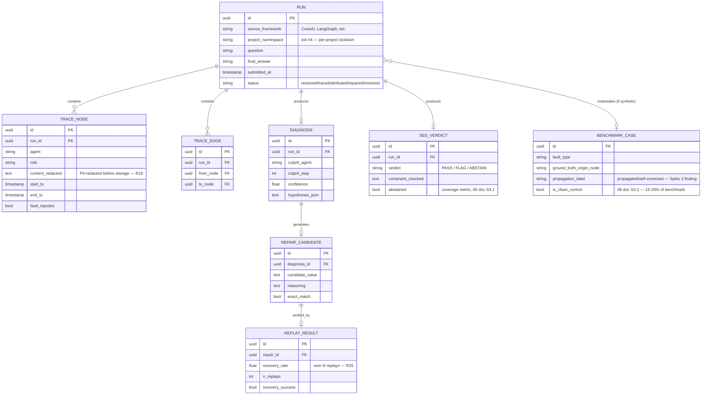
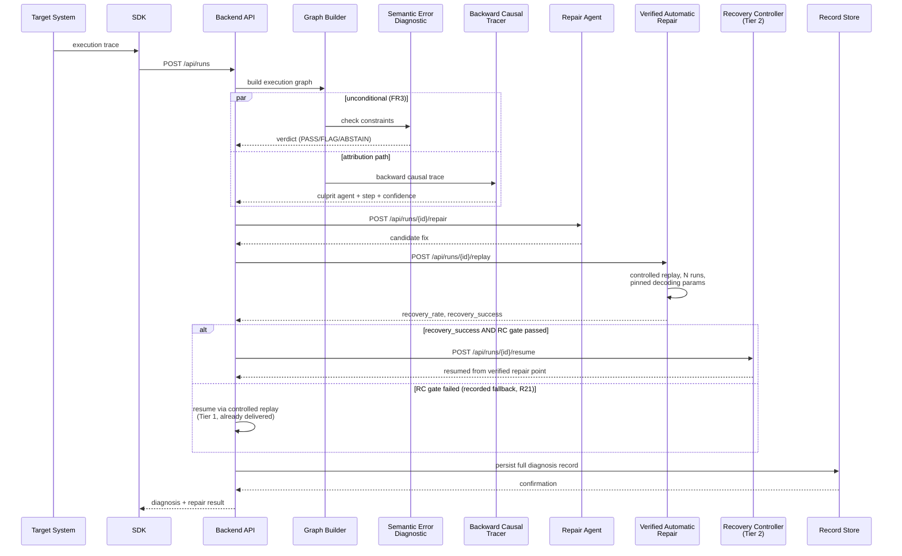
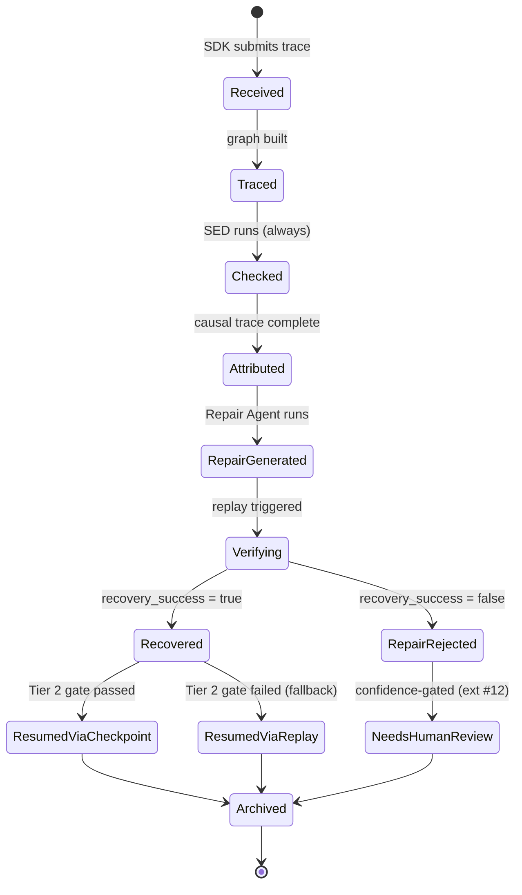
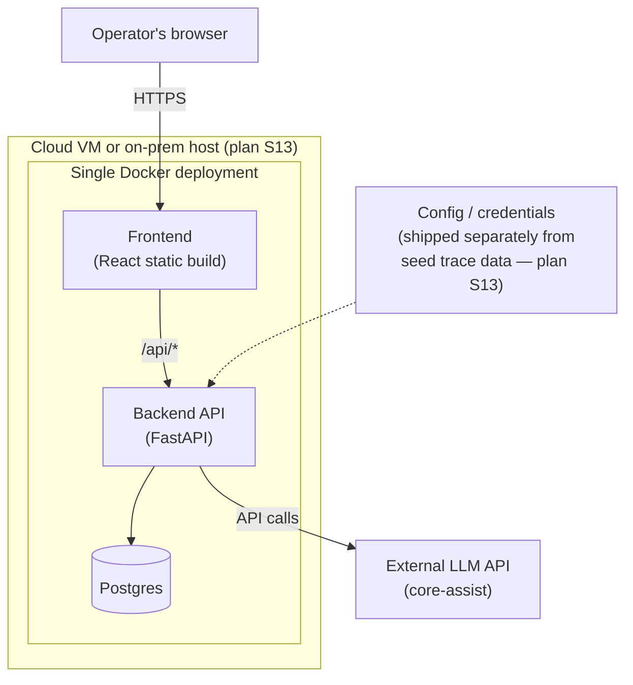

# Granite — Software Design Specification

*Status: **Mid-1-track working design, not proposal-defense material.** The guide places a full Software Design Specification ("components, data design, interfaces, security, deployment topology and failure handling") at **Mid-1** (§5.1's gate table), not the proposal defense — the proposal-stage requirement is the one-page [architecture-sketch.md](architecture-sketch.md), already complete and already cross-referenced against every other document in this repo. This document exists to prepare for that Mid-1 gate early, not to expand what's presented on September 11.*

*Written strictly from the **frozen** scope (plan doc §7.0, re-frozen 2026-08-25 per risk-register.md R27 with zero mechanisms added) — the 10 committed mechanisms, the 3-screen dashboard already pinned in [`06_Expanded_Scope_and_Feasibility_Plan.md`](../../06_Expanded_Scope_and_Feasibility_Plan.md) §6.5, and the tech stack already declared in [`FYP_Registration_Form_Answers.md`](../05-deliverables/FYP_Registration_Form_Answers.md). Genuinely new content here is component/data/API/schema-level detail that nothing else in the repo has specified yet — not new features. Where this document would need to introduce anything beyond the frozen scope, it says so explicitly in §1 instead of silently doing it.*

*This document does not repeat what's already established and audited elsewhere — it cites it. Problem statement, target users, competitive analysis, functional/non-functional requirements, the 12-month roadmap, team ownership, and the risk register all have a single source of truth already, and this document defers to it throughout rather than creating a second copy that can drift out of sync.*

---

## 0. What this document is, and isn't

| | |
|---|---|
| **Is** | Component-level architecture, database schema, API contract, and the sequence/state detail of the diagnose→repair→verify→resume loop — genuinely missing from the repo until now |
| **Is not** | A second requirements document, a second competitive analysis, a second roadmap, or a second team-ownership table — those exist and are linked, not duplicated |
| **Scope authority** | [FYP_Scope_CCP_and_Implementation_Plan.md](FYP_Scope_CCP_and_Implementation_Plan.md) §7.0 (frozen mechanism list) and [06_Expanded_Scope_and_Feasibility_Plan.md](../../06_Expanded_Scope_and_Feasibility_Plan.md) §4 (Core/Advanced/Stretch/Future bands) — if anything below conflicts with either, those two documents win |
| **When this gets used** | As the working reference during FYP-1's core build (weeks 6–16, per plan §12), and as the basis for the actual Mid-1 SDS submission |

**§1 below is the boundary that keeps this document honest.**

---

## 1. Explicit scope boundary — what this design deliberately does not include

Stated up front so nothing below can be mistaken for quiet scope expansion. Every item here was already excluded by name in the existing plan; this section only collects them in one place for design-review purposes.

| Excluded | Where it was already excluded | Why |
|---|---|---|
| Multi-tenant auth, billing, hosted SaaS signup | Plan §7.0 (13-item extension table, footnote): *"Deliberately dropped... real auth/billing infrastructure is generic SaaS plumbing that doesn't touch the CCP"* | Not a computing contribution; belongs to post-FYP productization (plan §14) |
| Message queue / event-streaming system (Kafka, RabbitMQ, etc.) | Never committed anywhere | The system's real-time need (SDK submits a trace, diagnosis runs, result returned) is a request/response workload at FYP scale (hundreds, not millions, of traces) — a queue would be infrastructure with no corresponding requirement |
| Kubernetes / multi-region / auto-scaling infrastructure | Plan §13: *"Single containerized deployment (Docker)... cloud VM or on-prem container target"* | Explicitly single-container; orchestration platforms solve a scale problem this project doesn't have |
| Elaborate caching layer (Redis, CDN) | resources.md §3: *"Redis / ElasticSearch AWS — optional, not needed at target scale"* | Named and explicitly deferred already |
| Full RBAC / multi-role authorization | Plan §7.0 extension #4 commits only to *"per-project API-key namespacing — no cross-project visibility, no auth/RBAC/billing system built"* | The committed mechanism is namespacing, not a role system |
| Disaster-recovery / backup infrastructure beyond stated failure handling | Plan §13's Failure and recovery row: *"Documented behavior when the LLM API is unavailable, when a trace is malformed, when the framework produces unexpected output shapes"* | That's the actual committed scope — not full DR (failover regions, backup rotation, RPO/RTO targets) |
| Any Tier 2 mechanism presented as already working | Recovery Controller and Verified Repair Memory sit behind pre-registered Mid-1 gates (plan §7.2, risk-register R21/R22) | Diagrammed below with their gate status marked explicitly, never presented as delivered |

---

## 2. What's already established elsewhere (cited, not duplicated)

| Topic | Source of truth |
|---|---|
| Problem statement, CCP justification | [FYP_Scope_CCP_and_Implementation_Plan.md](FYP_Scope_CCP_and_Implementation_Plan.md) §0.1–§2 |
| Target users / notional client | Plan §0.06 |
| Existing solutions & competitive gap | [Commercial_Product_Comparison.md](../03-market-and-literature-research/Commercial_Product_Comparison.md), [Full_Literature_Landscape_Analysis.md](../03-market-and-literature-research/Full_Literature_Landscape_Analysis.md) |
| Novelty & differentiation | Plan §4.1; [01_Executive_Audit_and_Verdict.md](../../01_Executive_Audit_and_Verdict.md) §5 |
| Functional requirements (5 FRs) | Plan §0.07 |
| Non-functional requirements | Plan §0.07 (latency <50%) + [06_Expanded_Scope_and_Feasibility_Plan.md](../../06_Expanded_Scope_and_Feasibility_Plan.md) §3.1–3.2 (statistical protocol, FPR <5% target) |
| Frozen mechanism list, two-tier core | Plan §7.0, §7.2 |
| 12-month roadmap, hour-level effort budget, MDP per gate | Plan §12; 06 doc §5.1, §5.3 |
| Team ownership | Plan §9; risk-register.md R24 |
| Risks, assumptions, dependencies | [risk-register.md](../02-evidence-and-tracking/risk-register.md) (R1–R29) |
| Tech stack declared | [FYP_Registration_Form_Answers.md](../05-deliverables/FYP_Registration_Form_Answers.md) — Python, FastAPI, Postgres, React (MERN-approximate), Docker, CrewAI/LangGraph, Ollama |
| Security/privacy threat model | risk-register.md R16 |

---

## 3. System context

The actors and boundary — what's inside Granite versus what it observes or calls.

**Note on the LLM boundary:** per plan §6's replacement test, every 0%-API component (graph construction, SED, causal tracing, confidence scoring) is unaffected if the LLM box were swapped — this diagram shows the LLM as one external dependency, not a component of Granite itself, deliberately.

---

## 4. Component architecture

Three lanes matching the committed ownership (plan §9, risk-register R24), broken down to module level — the granularity [architecture-sketch.md](architecture-sketch.md) intentionally stays above, since guide §6 only requires a one-page sketch at proposal stage.

**Explicit gate marking:** Recovery Controller and Verified Repair Memory are drawn *inside* the committed architecture (they are committed core, per plan §7.2) but labeled `TIER 2 — gated` because their delivery mechanism is conditional on the Mid-1 gate outcome (risk-register R21/R22) — resumption ships either via checkpoint (if the gate passes) or via controlled replay (Tier 1, already delivered) if it doesn't. The diagram does not hide this; it's the same discipline as the plan doc's own framing.

---

## 5. Data flow

One diagram for the six-hop sequence already stated in prose in [architecture-sketch.md](architecture-sketch.md) — this version adds the SED's parallel, unconditional check (FR3: *"independent of whether any explicit error signal was raised elsewhere in the trace"*), which the one-page sketch's prose doesn't visually separate from the sequential attribution path.

---

## 6. Database schema

**Genuinely new — nothing in the repo has specified a schema before this.** Grounded in a real, already-validated data shape: the fields below match the normalized `DiagnosisRun` structure `poc-demo/backend/data_loader.py` already proved out against real spike data (23 real runs, 8 real spikes) — this isn't a speculative design, it's the schema that shape implies once it needs to persist rather than be read from static files.

**Two fields worth flagging explicitly, because they encode committed decisions, not arbitrary design choices:**
- `TRACE_NODE.content_redacted` — not a raw field. R16's threat model requires regex PII redaction *before* storage; this schema has no path that stores unredacted trace content.
- `SED_VERDICT.abstained` — exists because FR3/06 doc §3.1 commit to reporting an abstention rate as a first-class metric, not silently dropping unclassifiable cases.

---

## 7. API contract

Marked explicitly by status — **some of this already exists as real, working code** (the `poc-demo` backend); the rest is the genuine gap this document fills. Nothing below is aspirational beyond the frozen FRs.

| Endpoint | Method | Status | Maps to |
|---|---|---|---|
| `/api/runs` | GET | **Real — built and verified** (`poc-demo/backend/main.py`) | List/filter runs |
| `/api/runs/{id}` | GET | **Real — built and verified** | Full diagnosis detail |
| `/api/stats` | GET | **Real — built and verified**, now reads the 5-run multirun aggregate | Headline metrics |
| `/api/runs` | POST | **New — the actual gap.** Accepts a raw trace from an SDK adapter, triggers the pipeline (§5) | FR1/FR2 |
| `/api/runs/{id}/repair` | POST | **New.** Triggers Repair Agent on an already-diagnosed run | FR4, item #6 |
| `/api/runs/{id}/replay` | POST | **New.** Triggers Verified Automatic Repair on a candidate | FR4, item #8 |
| `/api/runs/{id}/resume` | POST | **New, Tier 2 — only meaningful if the Recovery Controller gate passes.** Documented here with its conditional status, not hidden | Item #9 |
| `/api/benchmark/generate` | POST | **New**, Data/Benchmark owner's module | Fault injection harness |

**Why POST `/api/runs` is the one gap that matters most:** the entire `poc-demo` console is read-only over pre-recorded JSON — I said this plainly when I built it. This single endpoint is the difference between "a dashboard that replays what already happened" and "a system that diagnoses a trace it has never seen." Everything else in this API contract is secondary to getting this one right.

---

## 8. Sequence diagram — the diagnose→repair→verify→resume loop

The core interaction, end to end, with the Tier 2 branch shown honestly.

---

## 9. State diagram — one run's lifecycle

---

## 10. Deployment architecture

Exactly what plan §13 already commits to — one container topology, no invented infrastructure.

**No message broker, no orchestration layer, no multi-region replication** — matching §1's boundary exactly. Failure/recovery behavior (LLM API unavailable, malformed trace, unexpected framework output) is the plan §13 commitment, implemented as explicit error states in the sequence diagram above (§8), not as infrastructure-level redundancy.

---

## 11. Security & privacy — architectural implementation of R16

R16's threat model already names the mechanisms; this section places them on the diagrams above rather than leaving them as prose.

| R16 commitment | Where it lives architecturally |
|---|---|
| Regex PII redaction before storage | `TRACE_NODE.content_redacted` (§6) — the schema has no unredacted-content column |
| Per-project namespacing (ext #4) | `RUN.project_namespace` (§6) |
| Time-bounded retention | A scheduled deletion job against `RUN`/`TRACE_NODE` rows past the retention window — not yet built, named here as the Mid-1 design commitment |
| Minimum-context-per-call to the LLM | Enforced at the Repair Agent / Verified Automatic Repair call sites (§8) — only the relevant node's content is sent, never the full trace in bulk |
| No hard-coded secrets | `Config` box in §10, shipped separately from seed data per plan §13 |

---

## 12. Non-functional requirements → measurement point

| NFR | Target | Where it's actually measured |
|---|---|---|
| Diagnostic latency overhead | <50% (plan §0.07) | Timestamped at Backend API request boundary, §8's sequence |
| Silent-failure false-positive rate | <5% provisional (06 doc §3.2) | SED verdicts against the 15–20% clean-control slice of `BENCHMARK_CASE` (§6) |
| Recovery rate variance | Reported over N replays (R25) | `REPLAY_RESULT.n_replays` (§6) |
| Reproduction acceptance band | ±10 pts of 59.5% (plan §11) | Full 3-stage reproduction, out of this document's scope — it's the accuracy-critical spend `cost-estimate.md` already budgets |

---

## 13. What this document changes about the existing plan

**Nothing.** No mechanism added, removed, renamed, or rescoped. Every diagram above is a more detailed rendering of what plan §7.0/§7.2 and architecture-sketch.md already committed to. The only genuinely new decisions are implementation-level (schema field names, endpoint paths, the parallel-vs-sequential SED clarification in §5) — exactly the kind of detail the guide expects to firm up between proposal defense and Mid-1, not before it.

## 14. Open items for the team before this becomes the real Mid-1 SDS

- [ ] Confirm the schema in §6 against whatever the actual CrewAI/LangGraph adapter output looks like once real instrumentation hooks are built (plan §0.07's "most likely to change" note already flags this)
- [ ] Decide the retention window for R16's time-bounded retention (no number chosen yet — this document names the mechanism, not the value)
- [ ] Resolve the Case 6 agent-name normalization question (risk-register R28) into whatever attribution schema the real Verification Agent stage uses — the POC's `normalize_agent()` fix should inform, not be silently forgotten by, the real implementation
